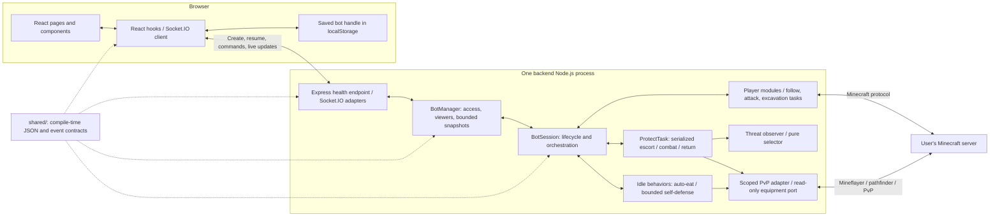

# Kanabot

> Minecraft-bot-as-a-service — spawn helper bots into any Minecraft server from your browser.

## Overview

Kanabot is a web platform that lets Minecraft players deploy, configure, and control helper bots via a browser dashboard. No setup required — just enter a server IP and click Deploy.

---

## Architecture

For gameplay roles, permission definitions, and the dashboard role editor, see [BOT_OWNERSHIP_DESIGN.md](docs/BOT_OWNERSHIP_DESIGN.md).

```text
Kanabot/
├── AGENTS.md                   # Repository-wide agent instructions
├── README.md                   # Setup and implemented architecture
├── backend/                    # Node.js + TypeScript (one process today)
│   ├── src/
│   │   ├── index.ts            # Express/Socket.IO composition + health endpoint
│   │   ├── sessions/           # Create/resume/stop and viewer socket adapter
│   │   ├── access/             # Fixed role grants, assignment store, authorization
│   │   ├── commands/           # Task permissions, command service, chat parser
│   │   ├── botManager.ts       # Stable IDs, access checks, observers, snapshots
│   │   ├── botSession.ts       # Mineflayer lifecycle + feature orchestration
│   │   ├── players/            # Roster, targets, whispers, player socket adapter
│   │   ├── behaviors/          # Idle auto-eat/self-defense and settings
│   │   ├── runtime/            # Shared scoped combat lease
│   │   ├── tasks/              # Follow/attack/excavation + modular protect/ runtime
│   │   └── types.ts            # Shared contract re-exports
│   ├── test/                   # Regression tests + simulated Mineflayer fixtures
│   ├── .nvmrc                  # Node.js 24.15.0
│   └── package.json
├── frontend/                   # React + TypeScript + Vite
│   ├── src/
│   │   ├── pages/              # Landing page and dashboard
│   │   ├── components/         # Deploy, player list, actions, armor, chat, log
│   │   ├── hooks/              # React state + Socket.IO adapters
│   │   ├── services/           # Framework-independent saved-handle storage
│   │   └── types.ts            # Shared contract re-exports
│   └── package.json
├── shared/                     # JSON data, player, lifecycle, socket contracts
├── docs/
│   ├── ARCHITECTURE.md         # Target design + implemented lifecycle foundation
│   ├── ROADMAP.md              # Local/cloud milestones
│   ├── spec.md                 # Feature and protocol specification
│   ├── KNOWN_ISSUES.md         # Deferred defects and architecture work
│   └── CHANGELOG.md
├── legacy/                     # Previous prototype, not the active application
├── tmp/                        # Historical product briefs and notes
└── run_all.sh                  # Local backend/frontend launcher
```

### Current component boundaries



Bot execution outlives browser connections. Socket disconnect removes a viewer and its telemetry interest; **Disconnect Bot** explicitly retires execution. The manager and bot runtime are independent of Socket.IO, while the current React hooks still contain client transport logic. Common contracts define payloads; they are not a runtime message broker or validator.

Sessions and recent history are currently in memory, with no database, account system, or separate worker processes. The cloud topology in [ARCHITECTURE.md](docs/ARCHITECTURE.md) is the target design, not the current deployment.

### Data Flow

```mermaid
sequenceDiagram
    participant U as Browser (User)
    participant F as Frontend (React)
    participant B as Backend (Express + Socket.IO)
    participant MC as Minecraft Server
    participant M as BotManager / BotSession

    U->>F: Fill in Server IP + Bot Name, click Deploy
    F->>F: Save stable bot handle locally
    F->>B: socket.emit('bot:create', config, handle, callback)
    B->>M: Create once and attach authorized viewer
    M->>MC: mineflayer.createBot()
    MC-->>B: 'spawn' event
    B-->>F: socket.emit('bot:state', { state: 'idle' })
    F-->>U: Show chat box, action panel, event log

    U->>F: Type chat message
    F->>B: socket.emit('bot:chat', sessionId, message)
    B->>MC: bot.chat(message)

    MC-->>B: in-game chat event
    B-->>F: socket.emit('bot:chat', { username, message })
    F-->>U: Append to chat box

    U->>F: Click "Follow [player]"
    F->>B: socket.emit('bot:action', sessionId, { type: 'follow', target })
    B->>M: Dispatch follow command
    M->>MC: FollowTask sets dynamic follow goal

    U->>F: Navigate away or close tab
    F-->>B: Viewer socket disconnects
    B->>M: Detach viewer and roster interest
    Note over M,MC: Bot continues; existing idle/task policies still apply

    U->>F: Return to dashboard or refresh
    F->>B: bot:resume(saved handle, callback)
    B->>M: Authorize and attach new viewer
    M-->>F: Snapshot via adapter: state, armor, bounded chat/events

    U->>F: Click Disconnect Bot
    F->>B: bot:disconnect(sessionId, callback)
    B->>M: Retire session and cancel retries
    M->>MC: Quit Minecraft connection
```

---

## Bot State Machine

```
disconnected ──spawn──► spawning ──success──► idle ◄──stop task──┐
      ▲                                          │                │
      │                                      start task           │
      │                                          ▼                │
      └──disconnect / idle timeout────────── task ───────────────┘
                                                 │
                                              dead (on bot death)
```

**States:**
- `disconnected` — no active connection to Minecraft server
- `spawning` — attempting to connect
- `idle` — connected, waiting for instructions
- `task` — executing `follow`, `protect`, `attack`, or `excavate` (only one task at a time)
- `dead` — bot was killed in-game (auto-reconnect attempted)

---

## Getting Started

### Prerequisites

- [nvm](https://github.com/nvm-sh/nvm) installed
- Node.js v24.15.0 (managed via `.nvmrc`)

### One-command startup (recommended)

```bash
bash run_all.sh
```

`run_all.sh` automatically:
1. Sources nvm and switches to Node.js 24.15.0 (installs it if missing)
2. Runs `npm install` in both `backend/` and `frontend/` if `node_modules` is absent
3. Copies `.env.example → .env` for each side if no `.env` exists yet
4. Starts both dev servers in parallel
5. Shuts both down cleanly on `Ctrl+C`

| Service | URL |
|---|---|
| Frontend | http://localhost:5173 |
| Backend API | http://localhost:3001 |
| Health check | http://localhost:3001/health |

---

### Manual startup

#### Backend

```bash
cd backend
nvm use
npm install
cp .env.example .env
npm run dev
```

#### Frontend

```bash
cd frontend
npm install
cp .env.example .env
npm run dev
```

---

## Environment Variables

### Backend (`backend/.env`)

```
PORT=3001
CORS_ORIGIN=http://localhost:5173
```

### Frontend (`frontend/.env`)

```
VITE_BACKEND_URL=http://localhost:3001
```

---

## MVP Features

- **Deploy bot** to any offline-mode Minecraft server
- **Real-time chat** — mirror in-game chat; send messages from browser
- **Follow** — bot follows a specified player, staying within 3 blocks
- **Protect** — escorts within 3 blocks, prioritizes supported hostile mobs around the player using damage evidence/proximity/visibility, and returns when separated by more than 12 blocks. Bounded decisions, target retention, path-failure cooldowns, and serialized cleanup live in independent runtime modules. `!guard` and legacy dashboard actions remain aliases.
- **Protect equipment placeholder** — melee requires an already-held sword/axe. No automatic selection/equipping is performed; losing the held weapon resumes escort-only behavior. The dashboard shows readiness and task state. Standalone Attack and existing armor/tool behavior are unchanged. See [Protect design](docs/PROTECT_DESIGN.md) and [equipment follow-up](docs/EQUIPMENT_DESIGN.md).
- **Armor auto-equip** — on spawn, bot equips the best available armor via `mineflayer-armor-manager`
- **Stop** — cancel current task, return to idle
- **Event log** — terminal-style stream of bot lifecycle events
- **Auto idle timeout** — bot disconnects after 10 min of inactivity
- **Retry logic** — reconnects on unexpected disconnect (up to 5 attempts)
- **Player list** — click-to-load dropdown with compact Minecraft Tab-style rows: skin icons, names, health hearts, and inline action icons; available locations, ping/game mode, search, and pagination
- **Player actions** — private whispers, follow, and confirmed attack with Stop controls; follow/attack use independent task modules with target, chunk, distance, pathfinding, and cancellation checks
- **Player roles** — assign usernames Visitor, Crew, or Owner on the dashboard, independently of the live roster. Visitor may follow; Crew adds protect/excavation; Owner adds attack/stop. Changes affect new commands while existing tasks continue.

Optional **Auto-eat** and **Self-defense** controls run only while idle. Choose Fight/Flight and a fixed response duration (1–120 seconds). Both default off, continue without a dashboard, and yield to tasks through the cleanup gate. Fight requires a held weapon; otherwise the bot flees. See [idle behavior design](docs/IDLE_BEHAVIORS.md) for scope, compatibility and resource ownership.

Roles and inherited grants are defined in `backend/src/access/roleCatalog.ts`; task-to-permission mappings are in `backend/src/commands/taskPermissions.ts`. Assignments are held in memory by `PlayerRoleStore` for each bot session and survive browser refresh, but not bot retirement or backend restart. Dashboard administrators remain independent of Minecraft player roles.

The proposed [Protect overhaul](docs/PROTECT_DESIGN.md) and [equipment-module follow-up](docs/EQUIPMENT_DESIGN.md) are awaiting approval. Protect's first implementation will use a read-only equipment placeholder; automatic equipment selection is a separate later scope.

### Player list and task modules

The roster reads Mineflayer's existing player cache; it does not query the Minecraft server or load chunks. It samples at most once every three seconds while the panel is open and the browser tab is visible, and sends only changed snapshots. Untracked players stay listed with unknown coordinates/health. Skin icons use the skin texture supplied by the server, with an initial fallback if none is available. Health is explicitly server-reported and can be hidden or altered by the server.

The bot row also shows ten hunger icons and available saturation from Mineflayer's own state. Other players' hunger is unavailable through the standard client protocol; no values are guessed. This uses the existing lazy three-second roster updates.

`backend/src/players/` contains roster projection, target validation, whisper handling, and the socket adapter. `backend/src/tasks/followTask.ts` and `attackTask.ts` share task lifecycle/cleanup in `trackedPlayerTask.ts`; these runtime modules do not depend on Socket.IO. JSON-only interfaces live in `shared/`. The in-process registry owns execution independently of browser sockets; persistent workers/accounts described in `ARCHITECTURE.md` remain proposed work.

### Leaving and returning to the dashboard

Navigation, refresh, tab closure, and temporary network loss detach the viewer; they do not stop the bot. The dashboard saves a stable bot ID and secret access token before deployment and automatically reattaches on return, restoring current state, cached armor, and bounded recent chat/events. **Disconnect Bot** explicitly stops and retires that bot for every attached viewer. The existing ten-minute idle timeout still applies; active tasks can continue without viewers.

This is a local, memory-only foundation: backend restarts lose sessions/history. One bot handle is remembered per browser origin and backend URL; tabs with the same handle can control that bot. Clearing browser storage loses access to it. The token is a local bearer capability, not a user account; keep this deployment local until hosted identity and operational controls are implemented. See [ARCHITECTURE.md](docs/ARCHITECTURE.md) for the design and [KNOWN_ISSUES.md](docs/KNOWN_ISSUES.md) for deferred bugs and architecture work.

Player contracts are the shared shapes for player records, roster snapshots, commands, and results. For example, `{ type: 'follow', target: 'Alex' }` describes an intent; the follow task implements it. These TypeScript definitions let the UI change without copying Mineflayer behavior, but do not themselves validate untrusted network input.

Follow and attack require a currently tracked player with a loaded target chunk within 64 blocks. They do not find hidden players or navigate portals. A dynamic follow goal tracks movement without restarting its search every second. Both tasks stop on target loss/death, bot dimension change/disconnect/death, failed paths, or 30 seconds without movement progress when outside the follow radius. Their pathfinding budgets are scoped and restored after cleanup; ordinary follow/attack will not dig or pillar through terrain. Stop cleanup must finish before another task can start.

Whispers use Mineflayer's `/tell` support and work for roster players outside tracking range where the server permits it. An acknowledgement means the command was submitted, not that the server delivered it. Sent/received whispers are labeled private in the dashboard; sending into the ordinary chat box remains public chat.

### Verification

With the Node version from `backend/.nvmrc` active, run `npm test` in `backend/` for the roster, permission/validation, follow/attack lifecycle, cancellation, and cleanup tests. These use simulated Mineflayer state; gameplay and server-specific private-message/PvP behavior still require a compatible Minecraft server. Run `npm run build` in each application for production compilation.

---

## Tech Stack

| Layer | Technology |
|---|---|
| Backend runtime | Node.js 24.15.0 |
| Backend framework | Express + Socket.IO |
| Bot engine | mineflayer + mineflayer-pathfinder + mineflayer-pvp + mineflayer-armor-manager |
| Frontend framework | React 18 + TypeScript |
| Frontend build | Vite |
| Real-time | Socket.IO (WebSocket) |
| Language | TypeScript (both ends) |
