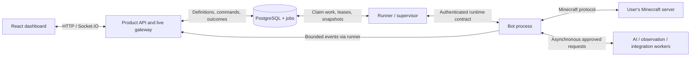

# Kanabot Architecture and Delivery Design

Status: target architecture with local lifecycle/task foundations implemented; other proposed components are not yet implemented. Updated: 2026-11-05.

This document explains how to deliver [ROADMAP.md](ROADMAP.md) through Local MVP, Local Stable (1.0), Cloud MVP, and Cloud Stable (1.0) with one application architecture. It describes boundaries to establish early, infrastructure to add only when needed, and the checks required to keep local/cloud behavior aligned.

## 1. Design position

Use a TypeScript monorepo containing a modular product backend, a React dashboard, and independently running Mineflayer bots. PostgreSQL stores durable product data and bounded background work. Start with all components on one host, then distribute worker execution as demand justifies it.

Keep the core domain model, commands, capability implementations, database, authentication engine, and runtime contracts consistent across milestones. Environment configuration determines deployment addresses, credentials, admission policies, limits, and enabled features.

Architectural consistency does not mean freezing physical topology or promising zero migration work. Additional worker hosts, an event-routing service, managed storage, or stronger isolation may be introduced later behind established interfaces. Avoid separate local/cloud implementations and database engines, which would create parallel behavior to maintain.

## 2. Proposed stack

| Area | Choice | Purpose and decision boundary |
|---|---|---|
| Frontend | React, TypeScript, Vite, React Router | Retain the current foundation; add bot lists, forms, history, and live subscriptions incrementally. |
| Product backend | Node.js, TypeScript, supported Express release | Account, permission, configuration, command, quota, and administration modules in one backend. |
| API and live updates | HTTP commands/configuration plus Socket.IO subscriptions | Browser connections observe owned bots; no bot lifecycle is tied to a transport connection. |
| Shared contracts | Zod runtime schemas and inferred types | Validate inputs at each trust boundary and share versioned command/event definitions. |
| Data | PostgreSQL plus Drizzle migrations/queries | Use the same relational model locally and in the cloud; keep configuration extensible through validated, versioned JSON where useful. |
| Authentication | Better Auth with database-backed sessions | Use one authentication implementation; bootstrap a local owner account and enable hosted login/recovery methods through configuration. |
| Durable work | pg-boss on PostgreSQL | Startup, bounded background operations, schedules, retries, and recovery notifications without a separate initial broker. |
| Bot execution | Mineflayer and vetted plugins in separate Node processes | Keep game computation separate from the API event loop; isolate bot failures and control execution capacity. |
| Integrations | Typed AI, observation, event, and advertising adapters | Bind external providers at the edge of the domain model; expose declared capabilities and limits. |
| Packaging | Shared build artifacts, container images, Docker Compose on one host | Reuse artifacts locally and in cloud deployment; keep persistent volumes, secrets, and environment configuration external. |

These are proposed selections, not dependencies installed by this document. Pin compatible versions during implementation and review supported Node/dependency versions at each release. The repository currently specifies Node.js 24.15.0.

The choices rely on existing library capabilities: [Zod validation](https://zod.dev/), [Drizzle database tooling](https://orm.drizzle.team/docs/overview), [Better Auth's Express integration](https://better-auth.com/docs/integrations/express), and [pg-boss transactional/background work](https://github.com/timgit/pg-boss). Their integration and failure behavior must still be verified in Kanabot.

## 3. Components and deployment

The diagram is logical. An optional integration processor may initially share the runner deployment, but heavy rendering must have independent concurrency/resource controls. The bot's physics, movement, and combat loops never wait for a database, dashboard, or model response.

| Deployment | Initial topology | What changes |
|---|---|---|
| Local MVP | Dashboard/API, PostgreSQL, runner, and bot child processes on one machine | Local credentials, loopback/private endpoints, explicit local server allowlist, low capacity. |
| Local Stable | Same components; optional integration/rendering processes | Hardened recovery, feature modules, backups, and tested packaging. |
| Cloud MVP | Same artifacts on one Linux host behind HTTPS | Hosted identity, public ingress controls, restricted egress, off-host backups, explicit quotas. |
| Cloud Stable | Same components; add worker hosts as justified | Host assignment, draining, event routing across gateways if needed, workload/region placement. |

Start with one bot child process per run for fault isolation and a clear lifecycle; measure its memory/CPU overhead. Admission limits must account for process overhead. A bounded pool for lighter workloads can be introduced if benchmarks justify it, while preserving the same run contract. Separate OS processes alone are not a security sandbox; apply non-root execution, resource limits, and appropriate network/filesystem isolation.

Keep bot children free of database-wide credentials. The runner owns assignment, heartbeat, supervision, and persistence using a restricted service identity; children receive only the configuration and short-lived authority needed for their assigned run. Public browsers never connect directly to bot worker ports.

## 4. Durable domain model

| Entity | Responsibility |
|---|---|
| User and session | Kanabot identity, account settings, authenticated sessions. |
| Server profile | Owner, address, authentication mode, tested compatibility, allowed capabilities, server permissions. |
| Bot definition | Stable bot ID, owner, server profile, versioned configuration, desired running/stopped state. |
| Bot run | One execution attempt: run ID, worker assignment, lease, observed state, timestamps, outcome. |
| Task | Capability, parameters, owner/actor, progress, checkpoint if supported, result, cancellation. |
| Command | Command ID, target bot/run, validated request, expiry, configuration revision, processing result. |
| Credential reference | Encrypted account/provider secret reference with owner/scope; secrets excluded from events, logs, and exports. |
| Event and snapshot | Bounded durable lifecycle history and latest state, with run ID and sequence/version. |
| Usage and policy | Bot runtime, AI/render usage, capacity allowances, feature availability, entitlement rules. |

Persist the core user/server/bot/run/command relationships in Local MVP. Add task checkpoints, sharing grants, schedules, memory, integration deliveries, and campaign records when their features are implemented. Do not build empty subsystems merely to reserve names.

A bot ID survives browser refreshes and process restarts. A run ID changes when execution is replaced. A Minecraft authentication identity is distinct from a Kanabot user and may have its own concurrent-use constraints.

Database migrations evolve one schema. Cloud rollout may expose a subset of available capabilities, but disabling a feature must not delete its saved local configuration or make older records unreadable. Version schemas and provide import/upgrade validation.

## 5. Command and recovery flow

1. The API authenticates a caller, validates the request, checks ownership/permissions and feature policy, and reserves relevant capacity/budget atomically.
2. It records a command and desired state with startup/job work in the same transaction, or uses a transactional outbox where an external transport is involved. Return a command ID and accepted status; acceptance is not proof of successful Minecraft execution.
3. A runner claims eligible work and establishes an assignment lease/run generation. Capacity checks also apply at claim time; queued work may expire or become ineligible.
4. A bot process receives validated commands for its active run. Start/stop/task transitions report explicit outcomes.
5. The runner persists important state/results and forwards bounded live events. Reconnecting dashboards fetch a fresh snapshot plus permitted recent history.
6. On failure or lease expiry, reconciliation compares desired and observed state, stops stale execution where possible, and reconnects/restarts according to policy and budget.

Use retry-safe command IDs, per-bot ordering/revisions, and stale-run rejection. A retry must not create duplicate starts or override a newer stop/configuration decision. Store task progress only at meaningful checkpoints; do not persist every physics tick.

Leases and generation IDs protect internal ownership and updates, but the Minecraft server does not understand Kanabot fencing tokens. An old worker must stop on lost authority, and replacement must account for an old connection that may still be alive. Test partition/replacement scenarios and do not claim exactly-once external game effects.

Not every command is replayable: chat messages, sponsored messages, item drops, and attacks can have ambiguous outcomes after a failure. Mark expired/unknown outcomes and use capability-specific replay policies. Resume excavation only after inspecting current blocks; otherwise report interruption and require an explicit restart.

Manual stop persists desired state as stopped, invalidates pending starts/retries, cancels tasks, and clears relevant timers. Runner/application shutdown must drain or terminate active children predictably. Browser disconnect only unsubscribes the viewer.

pg-boss jobs cover bounded startup/recovery operations, schedules, and background requests. After startup, the runner supervises the live connection through run state/leases; it does not keep an ordinary queue job open for the bot's entire lifetime. Durable command processing latency is separate from local game reaction latency.

## 6. Live state and transport

The dashboard subscribes by authorized bot ID. Authenticate subscriptions and recheck authorization when access changes. Each event identifies its bot/run and sequence so clients can reject stale updates and request a snapshot after gaps.

On one host, use a bounded local IPC/event path between runner and gateway. Important outcomes are persisted before they are represented as durable history. PostgreSQL notifications may wake consumers, but notifications are not durable event storage; polling/snapshot recovery handles missed signals.

When workers move to another host, preserve the same runtime envelope over authenticated private HTTP/WebSocket transport. Verify sender assignment and command scope; use short-lived service credentials and encryption in transit. Persistent queues/outcomes remain the recovery mechanism.

When multiple gateway replicas are actually required, add shared live-event routing behind the event transport interface. If Socket.IO polling remains enabled, configure load-balancer affinity as well as a suitable adapter; an adapter does not move in-memory Mineflayer objects between hosts. See [Socket.IO multi-node guidance](https://socket.io/docs/v4/using-multiple-nodes/).

Apply per-viewer subscriptions, bounded buffers, coalesced replaceable telemetry, chat/event retention, and backpressure. Dropping a superseded position update is acceptable; losing a durable stop result is not. The viewer path must never block emergency control or game logic.

## 7. Capability and task model

The initial [gameplay RBAC implementation](BOT_OWNERSHIP_DESIGN.md) uses fixed Visitor/Crew/Owner permission bundles and session-scoped username-role assignments. A pure evaluator and command service authorize Minecraft commands before runtime dispatch; dashboard assignment management uses separate deployment authorization. Edits apply immediately to new requests without stopping existing work. Stores remain in memory; durable task records/queues and distributed authorization ordering are future work. Task ownership and scheduling policies remain separate from RBAC.

Define a capability contract with a versioned ID, validated parameters/configuration, required permissions, declared resource use, execution/cancellation, progress/result events, and optional checkpoint/recovery methods. Feature availability is enforced in the API, runner, scheduler, and AI tool dispatcher, not just hidden in the UI.

The resource arbiter controls movement, combat, look direction, equipment, inventory, and interaction as needed. Local MVP can implement a small exclusive task model with non-conflicting passive chat/observation; expand concurrency only when demonstrated requirements demand it.

The delivered [local task lifecycle](TASK_LIFECYCLE.md) gives Follow, Attack, Protect and excavation one `TaskRuntime` contract and a transport-independent `TaskCoordinator`. It owns exclusive admission and observes cleanup-start/completion promises without inspecting concrete task classes. Task modules own cancellation and teardown; all task kinds retain ownership through pending or rejected cleanup. The shared wire projection adds task lifecycle details and the latest structured outcome, including partial excavation counts. This is a local resource lease, not a persisted capability registry, distributed scheduler or durable command protocol.

The delivered excavation slice adds a transport-independent application service for issuer-bound prepare/confirm/status/stop, pure bounded geometry, conservative external-world checks and incoming dig evidence under `backend/src/excavation/`. The existing task/equipment coordinator owns execution and handoffs. Plans and task history are bounded, in-memory and tied to the captured Minecraft connection; authorized dashboard reattachment receives the deployment plan/latest status without stopping execution. Browser adapters remain presentation/transport only. [Implemented scope](EXCAVATION_DESIGN.md#implemented-first-release) excludes remote survey and deep access planning.

The implemented [Protect runtime](PROTECT_DESIGN.md) applies those boundaries to escort/combat transitions and threat selection. `ProtectTask` owns serialized transitions and teardown; `ThreatObserver`, pure `ThreatSelector`, `ProtectCombatAdapter`, and the read-only `EquipmentPort` remain transport-independent. The session's exclusive task/cleanup gate is the local movement lease; no distributed scheduler is added. Shared `ProtectStatus` lets a replacement dashboard render execution without game rules. [EQUIPMENT_DESIGN.md](EQUIPMENT_DESIGN.md) documents the implemented equipment foundation and remaining optimization work. Future player-threat defense belongs to Protect invocation authority without a second RBAC check; player candidates are currently excluded. Stop cleanup must settle before a successor starts; failure is visible and holds the lease until retirement.

Examples of policies:

- Follow and excavation cannot independently command movement at the same time.
- Protect owns movement/combat and reads held-weapon readiness. Attack/Protect preparation, excavation tools, upkeep and manual armor writes use one captured-bot EquipmentService inventory lane; task item intent and cooperative handoffs coordinate food use.
- Passive chat and observation may run while moving, subject to their own limits.
- Emergency stop overrides tasks and model plans. Cancellation is propagated through asynchronous operations and has a tested termination path.

Implemented [Idle Behaviors](IDLE_BEHAVIORS.md) owns idle-only Fight/Flight and bounded Avoid drowning; Sleep stays TODO. [Bot Upkeep](BOT_UPKEEP_DESIGN.md) owns only Auto-eat/Auto-armor during or outside tasks. Their settings/status are separate, automatic execution has no requester/RBAC check, and dashboard configuration requires deployment access.

The delivered coordinator uses one serialized inventory lane and cooperative `EquipmentOwner` safe-point yields. Tasks publish generic revisioned item requirements; food reconciles current gear with readback before resume without importing task classes. Follow conservatively pauses for meals, while armor preserves compatible movement. A yielding task retains its task slot and cannot enable idle reactions. Unresolved cleanup blocks successors; synchronous commands return a retry explanation. No general lock engine, remote scheduler or new cloud infrastructure was added. The uncontrolled armor plugin entry point is no longer loaded. Selection limits, teardown and future-task obligations are documented in the upkeep/equipment documents.

Games use the same runtime capabilities, with participant permissions, start/stop rules, and bounded outcomes. Add a coordination module for small bot groups in Local Stable. Real-time per-bot reactions remain local; matchmaking/rankings and distributed match infrastructure are future product scope.

## 8. AI, observation, integrations, and advertising

### AI

Provider adapters expose supported text/vision/tool capabilities, timeouts, cancellation, usage, and cost estimates. Allow one tested provider initially. Track the worst-case allowed request budget before submission where possible, reconcile actual usage, and stop admitting work at configured limits.

Basic AI is conversation plus approved read-only context. Full AI proposes typed tasks through the same command/permission/arbiter path used by the dashboard. Owner confirmation policy governs destructive operations; world text and other players' messages never grant authority. Pending/stale plans must be canceled or revalidated after run/configuration changes.

Model failure must not stall deterministic assistance or combat. Persistent memory is opt-in, owner-scoped, bounded, and deletable. Keep provider keys and Minecraft tokens out of prompts and telemetry.

### Observation

Publish bounded structured observations of the world Mineflayer actually knows. Unloaded chunks and unseen entities are unknown, not empty. Basic observation needs no rendering service.

Add viewer/capture adapters for Local Stable; [Prismarine Viewer](https://github.com/PrismarineJS/prismarine-viewer) is a candidate for browser and headless paths. Prototype version support and host dependencies before selecting it. Rendering and vision requests have separate limits, cancellation, retention, and optional execution processes. Captures are associated with a run/timestamp so stale visual conclusions can be rejected.

A browser-rendered viewer does not automatically provide a trusted, server-side AI capture source. Explicitly choose and test the capture path for each supported visual feature. Store large captures in a storage adapter, initially on disk and later in private object storage if needed; keep metadata and ownership in PostgreSQL.

### External integrations and monetization

Adapters declare supported events/actions, schema versions, authentication, and destination/capability restrictions. Webhooks use bounded retry/expiry and delivery IDs; protect outbound destinations using the same networking principles as Minecraft endpoints. Arbitrary uploaded plugins require a separate future isolation design.

Website placements and in-game sponsorships use a campaign/policy module and ordinary approved delivery capabilities. Apply owner/server permissions, frequency limits, per-campaign disable controls, task priorities, and deduplication/unknown-outcome policies. Reporting uses minimal aggregate counters. Real ad-network enrollment and revenue settlement remain business decisions.

## 9. Environment differences and trust

| Concern | Local profile | Cloud profile |
|---|---|---|
| Identity | Explicit local owner bootstrap using normal account/session primitives | Hosted login/recovery and per-user isolation |
| Server destinations | Explicit owner-controlled localhost/LAN/server allowlist | Deny internal, loopback, link-local, metadata, and other restricted destinations; use vetted connector arrangements for private worlds |
| Networking | Loopback/private service endpoints; local browser origin | HTTPS, authenticated internal transport, restricted ports/egress, production origins/cookies |
| Credentials | Local secret source and protected persistent tokens | Hosted secret source, protected tokens, scoped access and rotation/revocation |
| Capacity | Operator-configured small limits | Atomic per-user/global admission, queue expiry, cost limits, suspension controls |
| Storage | Local PostgreSQL and private artifact volume | Same schema; off-host backups and private storage policy |
| Features | Local tier and configured provider capabilities | Server-enforced rollout flags intersected with permissions, capacity, and verified cloud compatibility |

The local profile must not turn into a general authentication bypass. Local network access is an explicit deployment policy; public request payloads cannot switch cloud workers into it. Destination checks must cover hostname resolution, SRV targets, redirects where applicable, and resolution changes. Network-layer egress restrictions complement application validation.

Keep the production dashboard/API on a compatible same-site cookie configuration; verify OAuth callbacks, CSRF protections, and live-session authorization. Kanabot authentication is separate from Microsoft authorization for Minecraft. Respect identity concurrency, server allowlists, and server-owner participation rules.

Shared cloud egress can trigger server-side per-IP limits or bans. Region placement, retry strategy, and per-destination admission must account for this; proxy rotation is not a default workaround. Modded-server support and private-world connectors are explicit integrations with their own trust and compatibility requirements.

## 10. Performance, capacity, and operating cost

Measure user-command latency separately from worker-to-Minecraft RTT and in-process game reaction time. Place future worker capacity near target Minecraft servers when measured RTT warrants it. The public dashboard's location does not determine combat latency.

Before setting concurrency, benchmark idle/chat, follow/protection, excavation, sparring/coordination, AI requests, and rendering. Record process memory, CPU, garbage collection/event-loop delay, network traffic, command latency, queue age, failures, and observed game responsiveness. Re-run affected benchmarks after capability/dependency changes.

Bound searches, loaded-world processing, regions, task duration, queue size, and observation frequency. Use workload classes for admission; an idle bot and a rendering/PvP workload need not consume equal capacity. Set hard host/user budgets rather than depending on unlimited autoscaling.

US$5/month is an initial constrained-pilot target. It does not establish a supported load or guarantee paid AI, rendering, backups, traffic, and availability within that total. Use measured costs, available resources, queueing, runtime allowances, and optional feature limits; recheck provider terms/prices at deployment time. Do not assume ads fund operating costs.

Add infrastructure only when a measured trigger justifies it:

| Trigger | Next change | Contract kept stable |
|---|---|---|
| One host reaches its CPU/memory budget | Add a runner host and explicit placement | Bot/run/task commands and outcomes |
| AI/rendering delays game work | Isolate its worker pool and concurrency budget | Provider/observation request contract |
| Multiple API gateways need live fan-out | Add shared event routing and transport-aware affinity | Authorized bot subscriptions and snapshots |
| Storage/restore needs exceed the single host | Move PostgreSQL/storage to suitable dedicated or managed services | Schema, migration, and storage interfaces |
| Minecraft RTT is unacceptable for a user region | Add a measured regional runner pool | Run assignment and compatibility rules |

A managed orchestration cluster, separate broker, and multi-region data layer are not initial requirements. Budget constraints may limit admitted users; they must not weaken ownership, secret protection, or stop controls.

## 11. Migration and verification plan

The local runtime now has browser-independent execution. `BotManager` owns stable bot sessions without importing Socket.IO. `sessions/sessionHandlers.ts` attaches transport observers; socket disconnect removes the observer and its roster interest without stopping the bot. The registry, runtime, and snapshots remain in one process and in memory, so this is a foundation for the target architecture, not durable cloud execution.

### Implemented local lifecycle foundation

- The browser prepares a UUID and a cryptographically random 256-bit access token and saves the handle before sending create. Retrying the same create returns the existing runtime instead of spawning another bot. The legacy field name `sessionId` now identifies the bot session, not a socket.
- A new connection presents the handle to resume. The manager verifies a SHA-256 token hash and attaches a viewer. All dashboard command handlers require an attached authorized viewer; knowing the public ID alone grants no control. Tokens are not included in state, history, logs, or URLs.
- Reattachment returns current bot state, cached armor, up to 200 chat messages and 150 events. History is bounded and ephemeral. Player telemetry remains opt-in; the final interested viewer leaving stops roster sampling, not execution.
- The frontend stores one handle per browser origin/backend URL in localStorage through an injected, React-independent storage module. Route unmount, refresh, tab closure, and transport loss do not send a bot-stop command. Reopening the dashboard resumes the saved handle. Storage must be available before deployment; clearing it loses this local capability.
- Explicit Disconnect Bot retires the session for all viewers and cancels pending retries. A retired ID cannot replay a create during this backend lifetime. The existing ten-minute idle policy still applies without viewers; observation does not renew it. Active tasks can continue without a dashboard.
- Retirement controls remain available to attached viewers in spawning/dead/disconnected states. Captured-connection teardown must confirm `end` before automatic replacement; late callbacks cannot revive a retired session. Unexpected uncaught process errors terminate the backend rather than continuing with uncertain state. Worker isolation and process supervision remain proposed infrastructure.
- Common JSON data, lifecycle responses, and socket interfaces are shared under `shared/`. Dates use ISO strings on the wire. Runtime schemas and uniform legacy-command outcomes remain follow-up work.

This change is worth establishing before the UI overhaul: execution ownership, stable identity, and observer separation also apply to persisted accounts and remote workers. The local bearer capability is temporary scaffolding, not the proposed account system. Backend restart still loses all sessions; missing handles are cleared on resume. Multi-bot account discovery, worker isolation, durable replay protection, and quotas remain future work. Detailed deferred defects are tracked in [KNOWN_ISSUES.md](KNOWN_ISSUES.md).

Implement in small, verifiable slices:

1. Complete shared runtime schemas and command/client extraction around the implemented stable-ID, observer, and shared-type boundaries.
2. Introduce authentication, persisted owners/server/bot definitions, stable IDs, and command authorization. Update the dashboard to target bot IDs and reconnect to snapshots.
3. Move execution behind the runner/process contract. Add run records, desired/observed state, command persistence, admission, stop semantics, and recovery.
4. Harden assistance and add the bounded game using the capability/arbiter interface. Then add AI and observation through their adapters.
5. Complete the Local Stable scopes in the roadmap, including tested packaging, credentials, sharing, integrations, and monetization paths.
6. Promote the same artifacts to the restricted cloud profile, then widen rollout only after hosted validation and operating evidence.

Maintain deterministic unit/contract checks for ownership, schema validation, state transitions, budget reservation, retry/stop, and stale events. Use an integration fixture with supported Minecraft server versions for movement, combat, digging, and account-mode checks. Mock external providers for failure scenarios and separately verify the supported real-provider paths.

Local and cloud-profile CI should run the same contract/end-to-end scenarios with environment-specific network and identity fixtures. Test dashboard disconnects, duplicate requests, canceled/expired jobs, lost heartbeats, stale workers, Minecraft outages, provider timeouts, and restore/upgrade behavior. Each milestone's roadmap criteria are the release gate.

Run disposable cloud smoke deployments during local development once the foundation works. Exercise runtime images, TLS/login callbacks, real remote connectivity, resource limits, rendering dependencies, and off-host restore before the Cloud MVP release. This reduces surprises without changing the four-milestone order.

Use versioned command/event/configuration contracts, backward-compatible migrations where practical, and worker draining for releases. Stop admission before shutting down a runner. A database rollback is not assumed to be safe after destructive schema changes; document forward repair or tested restore procedures. Preserve local/cloud export compatibility without exporting secrets.

## 12. Decisions still to resolve

- First supported Minecraft versions, authentication modes, and sparring rules.
- Login methods/recovery flow and the initial sharing model within the proposed account architecture.
- Supported AI/vision providers, capture source, credential custody, and request budgets.
- Concrete pilot hardware/region, concurrency limits, latency objectives, and retention periods after benchmarking.
- Whether advertising is activated and which server-owner opt-in and delivery formats are approved.
- Private-world connector scope and the acceptable availability/recovery tradeoff at the initial budget.

These decisions refine adapters, policies, and release scope. They should not require replacing the persistent bot model, task engine, or separation between browser subscriptions and bot execution.
