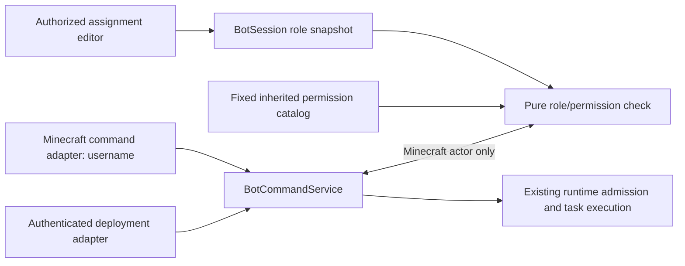

# Bot gameplay RBAC

Status: initial implementation, 2026-11-03. Describes the shipped local permission boundary and its extension points. Cloud persistence, queued task records, custom scheduling, and future capabilities remain roadmap work.

See [ARCHITECTURE.md](ARCHITECTURE.md) for system boundaries and [KNOWN_ISSUES.md](KNOWN_ISSUES.md) for deferred runtime defects.

## 1. Behavior

Every valid Minecraft username has one effective role per bot:

- **Visitor**: implicit default, may request follow.
- **Crew**: inherits Visitor and adds guard and bounded excavation.
- **Owner**: inherits Crew and adds attack and stop-current-task.

The application defines all roles and permissions. Deployment administrators can assign or remove a player's role on the dashboard; they cannot change role definitions or permission thresholds. Names are case-insensitive, and offline names can be assigned without opening the live player roster. Removing an assignment restores Visitor access.

There is at most one named Owner. Assigning Owner transfers that role atomically from the previous Owner, who returns to Visitor. Removing Owner is allowed; Visitor tasks remain available without an Owner assignment. None of these gameplay roles grants deployment administration.

Assignment edits affect subsequent commands immediately, without player reconnect or bot respawn. They do not stop or change existing tasks. RBAC evaluates the player making the request, not the task's target or the player who started the existing task. Explicit stop requires the current caller's stop permission regardless of task initiator. Higher-role requests do not preempt current tasks.

## 2. Separate access systems

| Boundary | Identity | Authority |
| --- | --- | --- |
| Deployment administration | Existing authorized browser capability; future Kanabot account | Manage assignments, issue dashboard commands, configure/retire deployment, view permitted dashboard data |
| Minecraft gameplay RBAC | Sender username scoped to this bot/server | Request operations in the role's permission set |

A web administrator need not have a Minecraft identity. Assigning Steve123 as Owner does not give Steve123 the browser access token or web API authority. Dashboard controls retain their deployment authorization and do not impersonate a Minecraft Owner. Internal adapters construct actor context; client payloads cannot choose an elevated actor type.

## 3. Where definitions and assignments live

| File | Responsibility |
| --- | --- |
| [`backend/src/access/roleCatalog.ts`](../backend/src/access/roleCatalog.ts) | Fixed role IDs, labels, direct/inherited permission grants, catalog version, username normalization |
| [`backend/src/commands/taskPermissions.ts`](../backend/src/commands/taskPermissions.ts) | Maps follow/guard/excavate/attack/stop operations to named permission IDs |
| [`shared/accessContracts.d.ts`](../shared/accessContracts.d.ts) | Shared compile-time role/permission IDs, assignment snapshots, update/result shapes |
| [`backend/src/access/playerRoleStore.ts`](../backend/src/access/playerRoleStore.ts) | Runtime username-role assignment map and revision, one store per BotSession |
| [`backend/src/access/playerAuthorization.ts`](../backend/src/access/playerAuthorization.ts) | Pure grant check, without transport or task dependencies |
| [`backend/src/commands/botCommandService.ts`](../backend/src/commands/botCommandService.ts) | Validates commands, authorizes Minecraft actors, dispatches to existing runtime execution |
| [`backend/src/commands/minecraftCommand.ts`](../backend/src/commands/minecraftCommand.ts) | Exact chat-command parsing, separate from role rules |

Role inheritance is permission-set composition, not priority weights or redundant player assignments. The catalog builds Crew from Visitor's grants and Owner from Crew's grants. Callers ask for a named permission; task modules never compare role ranks.

Assignments are stored in backend memory, not in a file, browser storage, or database. They survive dashboard refresh, transport reconnect, and Minecraft reconnect/death within the same BotSession. Retirement or backend restart discards them. A new session starts with Visitor defaults. This matches the current in-memory lifecycle; persistence belongs with future durable bot definitions. The assignment store caps explicit entries at 1,000 per bot.

To add a new operation later: declare its shared permission ID, map the operation to that permission, grant it in the appropriate fixed role bundle, wire its validated command and runtime behavior, and add allow/deny tests. New permission IDs receive no implicit wildcard grant. Update the catalog version when its policy changes. Merely defining an ID does not implement a task such as trade.

## 4. Current permission matrix

| Operation | Permission ID | Visitor | Crew | Owner |
| --- | --- | --- | --- | --- |
| Follow | `task.follow.start` | Yes | Yes | Yes |
| Guard | `task.guard.start` | No | Yes | Yes |
| Excavation | `task.excavate.start` | No | Yes | Yes |
| Attack | `task.attack.start` | No | No | Yes |
| Stop current gameplay task | `task.stop` | No | No | Yes |

No requester/initiator comparison affects these grants. Feature availability, valid targets, pathfinding limits, region bounds, and busy-task rejection remain separate execution checks. Stop task is different from retiring a bot through Disconnect Bot. Runtime safety stops remain available independently of player roles.

For the proposed [Protect capability](PROTECT_DESIGN.md), invocation permission authorizes the eligible defensive behavior of that task. Future automatic player-target defense will not require another RBAC check or standalone Attack permission. The first Protect implementation targets mobs only; future player eligibility/friendly exclusions and server PvP rules remain target/execution policy. Standalone Attack continues to have its own permission.

## 5. Command and execution boundaries

The existing session socket handler checks deployment attachment before commands. Player-list follow/attack and dashboard task actions use the same command service boundary. In-game commands construct a Minecraft actor and must pass RBAC. Whispers and ordinary dashboard chat remain deployment-authorized operations, not player task permissions.

The chat adapter supports exact `!follow [player]`, `!guard [player]`, `!attack [player]`, `!stop`, and `!dig`/`!excavate` with six coordinates. Prefixes such as `!followExtra` do not invoke tasks. Targets and coordinates are runtime-validated before dispatch. Invalid coordinates, including non-finite/fractional values, are rejected; excavation volume is capped at 10,000 blocks.

Denied/rejected in-game commands appear in the dashboard event log and receive a private `/tell` response when the server supports it. Rejection does not stop an existing task or reset idle budgets. Authorization approval and successful gameplay are different: a permitted task may still be unavailable, busy, or unable to reach its target.

Task modules contain Mineflayer behavior, not role checks. The pure evaluator has no queue, current-task owner, or scheduling state. Future preemption/fairness or task-ownership rules belong to a separate coordinator policy. Current execution has no persistent task queue or durable task authorization records; future scheduling should preserve the accepted rule that policy edits affect new task creation, not already-created work.

## 6. Live updates and API

Role management uses dedicated Socket.IO events:

| Event | Payload/result | Authorization |
| --- | --- | --- |
| `bot:access:get` | Session ID; callback with `PlayerAccessResult` | Attached deployment viewer |
| `bot:access:update` | Session ID, username, fixed role or null, expected revision; callback result | Attached deployment viewer |
| `bot:access` | Snapshot containing session ID, revision, catalog version, roles, assignments | Server broadcast to attached deployment viewers |

The full session resume snapshot also includes access state. Role edits broadcast immediately to all attached viewers. The frontend hook loads role state independently from player telemetry, rejects older snapshot revisions, and ignores stale acknowledgements after session/connection changes.

Updates validate names, roles, and revision at runtime. A stale revision produces `CONFLICT` and the editor refreshes assignments; it does not silently overwrite another viewer's edit. Owner transfer is part of a single synchronous update. Current in-process authorization and dispatch are synchronous, so no assignment edit can interleave their critical section.

`BotCommandService` checks new operations against the authoritative current store. It does not subscribe to changes or cancel running work. New stop requests use current permission, even if the caller previously had another role. Assignment management never calls the task stop/start methods.

## 7. Username identity and scope

Player keys use validated Java-style usernames normalized to lowercase; display spelling is retained. Admin input is trimmed; incoming sender metadata with invalid whitespace is rejected. Missing/ambiguous/system identity does not receive Visitor access.

The store belongs to a BotSession with immutable server configuration. A name on another bot has no inherited assignment. New sessions/server contexts start with empty assignments. If mutable server profiles are added later, explicit assignment scoping/reset must accompany that change.

Username authorization follows a name, not a verified person. Renames require manual reassignment; old names retain access until removed, including if reused. A server/proxy that impersonates sender metadata defeats username identity. No UUID lookup or web-account linking is required by this feature, and these limitations are not represented as stronger authentication guarantees.

## 8. Testing through the dashboard

1. Deploy a bot and open **Player roles** below the collapsed server-player bar.
2. Enter the actual in-game username, choose Crew or Owner, and click **Assign role**. Names may be offline. The form displays the fixed role permissions and any current Owner transfer warning.
3. In Minecraft, try a restricted command before/after assignment: a Visitor cannot `!guard Alex`; Crew can request it when Alex is observable and the bot is idle. Only Owner can `!attack Alex` or `!stop`.
4. Change/remove the role while a task runs. Existing work continues; subsequent commands use the updated role. Use deployment dashboard Stop/Disconnect controls for administrative recovery.
5. Refresh the dashboard: assignments remain with the same session. Removing a row returns that player to Visitor. Assigning Owner to another name transfers the single Owner role.

RBAC does not fix gameplay/cancellation defects; see KI-002 and other entries in [KNOWN_ISSUES.md](KNOWN_ISSUES.md). Do not use this feature as proof that a permitted task can reach every world location or that offline usernames are authenticated accounts.

## 9. Verification and roadmap

Automated coverage includes inherited grants and unknown-ID denial, normalization/isolation, stale revisions, atomic Owner transfer, invalid command parsing, new-request promotion/demotion, unchanged running tasks, deployment management access, and broadcast/resume retention. Tests use simulated Mineflayer state. Browser checks exercise assignment, removal, and refresh without opening the live roster.

Future durable storage should persist assignments with bot definitions using the same repository/evaluator boundary. Distributed command admission needs one authoritative ordering point for assignment updates and task creation; stale gateways must not create newly forbidden tasks after an update is acknowledged. Already-created tasks retain their creation authorization. Worker envelopes must still be authenticated and scoped to the task/run.

Gameplay RBAC does not imply account billing rights, private history visibility, or unlimited AI/integration spending. Those controls remain in their respective modules. Role catalogs and UI can expand without changing task scheduling, browser-independent lifetime, or low-level Mineflayer implementations.
