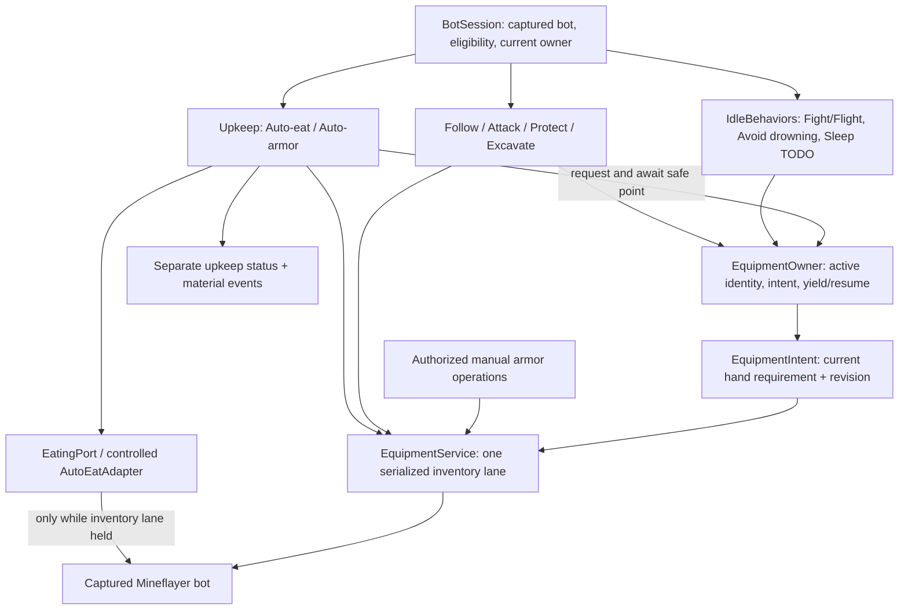

# Bot Upkeep and Idle Behaviors

Status: **implemented local runtime**, 2026-11-04. This document describes the delivered coordination model and its limits. [Equipment details](EQUIPMENT_DESIGN.md), [idle behavior details](IDLE_BEHAVIORS.md), and the [architecture](ARCHITECTURE.md) cover the adjacent boundaries.

## 1. Two modules with distinct missions

**Idle Behaviors** only act when no foreground gameplay task exists. **Bot Upkeep** maintains food and armor during or outside tasks. They have separate settings, status, and feature ownership.

| Feature | Sole owner | Current scope |
| --- | --- | --- |
| Fight or flight / Self-defense | Idle Behaviors | Opt-in, identified attacker, fixed user-set response duration |
| Avoid drowning | Idle Behaviors | Opt-in, bounded path to observed air directly above; idle only |
| Sleep | Idle Behaviors | **TODO**, disabled in the UI; no implementation |
| Auto-eat | Bot Upkeep | Opt-in, safe handoff from all current foreground tasks |
| Auto-armor | Bot Upkeep | Opt-in, head/torso/legs/feet; compatible movement continues |

There are no other upkeep candidates in this scope. Item reconciliation, observation, and logging support these two features; they are not extra selectable upkeep features.

A task yielding for food **retains its task slot**. It cannot enable idle Fight/Flight or Avoid drowning. Upkeep and idle reactions do not import each other's implementations. Outside foreground tasks, an existing idle response can expose the same equipment-owner contract: food can temporarily yield Fight/Flight, while armor can accompany movement. The response's original deadline still runs. Avoid drowning refuses food handoff while surfacing; armor can still run. A new self-defense response does not start while upkeep owns an operation.

## 2. Actual runtime boundaries



The approved resource-coordination concept is implemented conservatively with **one inventory promise lane plus cooperative task handoffs**, not a general six-resource lock manager or new task scheduler. Upkeep waits for the task's safe point **before** acquiring inventory ownership. A task never waits for food while holding that lane. Armor needs no movement yield and excludes held/task-reserved source items. BotSession's existing task and cleanup gates prevent a successor from starting during a pending handoff.

`Upkeep` depends only on `EquipmentOwner`, `EquipmentService`, and `EatingPort`, not task classes, roles, sockets, or React. BotSession supplies the current owner and lifecycle eligibility. Each connection captures its own bot and service; runtime promises and Item objects stay inside the worker. No database/model/dashboard round trip enters the action loop. This preserves the local/cloud boundary without introducing infrastructure.

## 3. Why the libraries need additional logic

| Library | Used capability | Application responsibility |
| --- | --- | --- |
| `mineflayer-auto-eat` **5.0.3** | Food selection, equip, consume | Eligibility, safe points, cancellation cleanup, inventory ownership, current task item restoration/readback |
| `mineflayer-armor-manager` 2.0.1 | Source reference only; **no longer loaded** | A small four-slot selector and executor now live in EquipmentService, under the Auto-armor toggle |

The food plugin knows neither the active task nor its desired item. Its `returnToLastItem` option restores the former item rather than the current requirement, and the inspected version does not await that restoration. Its autonomous physics loop is disabled. `AutoEatAdapter(bot, false)` also disables the adapter's legacy old-item restoration: **EquipmentService is the sole post-meal restoration owner in runtime composition**. The default adapter mode remains for direct compatibility tests, not a second running controller.

The version-pinned adapter still replaces the plugin instance's private consumption wait, removes its exact listeners/timer on settlement, contains early cancellation/equip failures, resets the eating flag after owned work settles, and deactivates item use. Package files are unchanged. Review these private hooks when upgrading. [Food source](https://github.com/linkle69/mineflayer-auto-eat/blob/master/src/new.ts)

The armor plugin has an autonomous collection callback without a comprehensive public disable gate. Wrapping only `equipAll()` would leave uncontrolled writers. Runtime composition therefore no longer loads that plugin; its dependency remains installed for now. Selection uses current inventory and supported Mineflayer `equip`, with verified destination readback. No plugin-internal import is treated as a public API. [Armor source](https://github.com/G07cha/MineflayerArmorManager/blob/master/src/index.ts)

## 4. Generic task item requirements

The implemented internal contract is in `backend/src/runtime/equipment.ts`:

```typescript
type HandRequirement =
  | { kind: 'unrestricted' }
  | { kind: 'empty' }
  | { kind: 'specific'; item: Item }
  | { kind: 'best'; policy: string; context?: { position: { x: number; y: number; z: number } } };

interface EquipmentOwner {
  readonly active: boolean;
  readonly equipmentIntent: EquipmentIntent; // requirement + monotonically increasing revision
  pauseForUpkeep(signal: AbortSignal): Promise<boolean>;
  resumeAfterUpkeep(): Promise<void>;
  refreshEquipmentIntent?(): void;
}
```

Owner object identity and its captured cancellation/lifecycle represent the active execution; this is not a persistent or wire contract. A future durable task identifier can be added at the worker boundary. Every current task implements this contract, including Follow's explicit unrestricted requirement. Future tasks must implement it and register with session ownership before during-task upkeep is enabled for them. A task without a known active owner is ineligible for during-task upkeep, rather than assumed safe.

Tasks publish **intent**, not the item currently visible in `heldItem`. Food never switches on task names. A new selection policy is registered through `EquipmentService.registerPolicy()`. Specific-item matching uses reference where current, otherwise type/metadata/NBT/components; original slot is a preference, not a permanent identity. Identical copies remain interchangeable; Item objects are not persisted.

| Requirement | Delivered behavior |
| --- | --- |
| Best `melee` | Supported usable sword/axe, material tier first, sword preference, small Sharpness tie weight, stable slot tie-break |
| Best `mining` | Re-fetch current block and rank usable inventory items by `block.digTime`, enchantments/effects, stable slot tie-break; retains excavation's non-harvest-required scope |
| Specific item | Restore a matching current item; no substitution with an arbitrary weapon |
| Empty hand | Switch to a checked empty hotbar slot; block if none exists, **never drop an item to satisfy this requirement** |
| Unrestricted | Preserve the prior item if still safely available; no automatic weapon choice |

These initial rankings are explicit heuristics, not universal DPS/armor optimizers for every version, enchantment, or custom server. See [EQUIPMENT_DESIGN.md](EQUIPMENT_DESIGN.md) for policy limits. Raw `unequip('hand')` is not used to satisfy empty hand because its fallback can drop items. [Mineflayer inventory implementation](https://github.com/PrismarineJS/mineflayer/blob/master/lib/plugins/simple_inventory.js)

## 5. Post-meal guarantee and safe points

**A task must not resume hand-dependent work until its current requirement has been reconciled and read back.** Eating temporarily replaces the held tool; the guarantee is verified restoration before conflicting work resumes, not continuously holding a sword and food in the same hand.

```mermaid
sequenceDiagram
    participant U as Upkeep
    participant T as EquipmentOwner
    participant E as EquipmentService
    participant F as EatingPort
    U->>T: Request safe-point yield
    T->>T: Drain startup/combat or finish current dig/segment
    T-->>U: Yield acknowledged; task remains active
    U->>E: Acquire inventory lane
    U->>F: Await one meal attempt
    F-->>U: Success / error / cancellation, fully settled
    U->>T: Refresh current intent if observations changed
    U->>E: Resolve, equip, verify current intent revision
    alt Requirement satisfied and same owner still active
        E-->>U: Current readiness verified
        U->>T: Resume from fresh world/target state
    else Required item absent or uncertain
        E-->>U: Blocked with reason
        U->>U: Keep task suspended; bounded retry or retire
    end
```

Reconciliation runs after successful, failed, or canceled meals, while inventory ownership is retained. It re-reads the current owner/intent, checks cancellation and active identity, and retries a changed revision up to three times. Missing/broken required gear leaves the yielded task suspended, publishes a reason, and retries readiness after backoff. No accidental bare-handed continuation. Stopped/replaced tasks are never resumed; current-task restoration is skipped on disconnected/dead contexts. A meal timeout alone does not release ownership.

| Owner | Actual handoff |
| --- | --- |
| Follow | Briefly clears movement, retains target observers/task slot, then installs a fresh dynamic follow goal after restoration |
| Attack | Drains startup and scoped combat, including tracked pending `lookAt` continuations; revalidates player and weapon before restarting |
| Protect | Pauses serialized decisions/watchdog progress, drains scoped combat and goal, retains observations; recomputes threats on resume |
| Excavate | Waits for a checkpoint between navigation/tool/dig steps, finishes the current uncancelled dig; re-fetches block and required tool before the next dig |
| Idle Fight/Flight | Same handoff contract; original response deadline continues and dead targets are not restarted |
| Idle Avoid drowning | Defers food handoff while its bounded escape is active |

Follow's brief food pause is a deliberate first implementation limit; armor does **not** clear its goal. Safe consumption while walking can later be optimized inside Follow's adapter without changing food policy. Excavation refreshes an obsolete block requirement if that block disappeared during food use. Target death/loss/Stop still terminate a paused task through its own observers.

Protect/Attack prepare melee gear at startup and after meals. This does not implement continuous automatic weapon replacement after every hit or a full combat-equipment optimizer. Protect still degrades to escort when normal held-weapon readiness is lost outside a handoff.

## 6. Eligibility, cadence, armor and manual actions

- One assessment timer per connection, once per second; one mutating upkeep operation at a time, five-second backoff after an attempt, and at least three seconds between armor assessments. Cached own state only; no new entity scan, path search per player, or roster subscription.
- Food has priority when eligible: finite hunger below 20, with hunger at most 15 **or** health below 14. Full hunger prevents ordinary food consumption even at low health; healing depends on server regeneration. No food acquisition is implemented. Missing food/registry/plugin status is explicit and warnings are limited to once per 30 seconds.
- Armor reselects from current inventory, checks usable durability and a documented material/Protection heuristic, then awaits and verifies each improved slot. Held and task-reserved items are excluded. Offhand/shields are outside scope. It never starts an independent movement/combat controller.
- New bots default both toggles off. Auto-armor off means no automatic spawn/collection path remains. Manual dashboard slot removal enters the same inventory lane and protects that slot until Auto-armor is disabled then re-enabled, or a new Minecraft connection is created.
- An open container window defers new upkeep. New manual armor commands cancel/wait for upkeep through the existing retry gate. They do not silently close a task's window or undo its intended hand requirement.
- Task requests during cleanup are rejected with a retry explanation, not silently queued. New idle responses are ineligible while upkeep owns work. Armor transactions can continue alongside existing compatible movement.

## 7. Lifecycle, teardown, and failure

Disable/Stop/death/world change abort the appropriate operation. Retirement/reconnection disposes the old controller, its one-second timer and exact death/game/end listeners. Idle and foreground owners retain their own cancellation, event observers, movement settings and terminal cleanup. Browser loss only detaches observation.

The 15-second handoff/operation deadline aborts and publishes `cleanup-failed`, **without pretending an unresolved equip/consume promise has finished**. Conflicting task/manual starts remain blocked until the operation actually settles; a late successful drain may release the gate. A rejected/uncertain handoff remains visibly failed and requires retirement. Missing required gear is a recoverable `blocked` status, not an uncontrolled retry loop.

Food listeners/deadlines stay alive long enough to settle consumption. The inventory lane remains held through restoration/readback. Task teardown drains combat startup, pending scoped looks/stops and owned motion before restoring saved plugin/pathfinder settings. Excavation checks cancellation after each await and requests/drains `stopDigging()` for an active dig. All foreground tasks use the shared [TaskRuntime/TaskCoordinator contract](TASK_LIFECYCLE.md): a terminal outcome follows confirmed cleanup, while cleanup rejection retains ownership and blocks successors. Old connection callbacks cannot clear a successor's task.

Do not globally remove listeners, force-release a pending inventory transaction, replay uncertain consumption after restart, or persist live Item references/promises. These are per-worker execution mechanics.

## 8. Dashboard, contracts, and migration

Separate **Idle Behaviors** and **Bot Upkeep** panels configure backend policy and render authoritative status. Shared JSON contracts are `shared/behaviorContracts.d.ts` and `shared/upkeepContracts.d.ts`; authenticated attachment is required for `bot:behaviors:update` and `bot:upkeep:update`. Automatic execution has no player requester and no gameplay RBAC check. Role changes still apply only to newly submitted commands.

A legacy `autoEat` field on a behavior settings request is accepted at the session boundary and forwarded to Upkeep, then omitted from Idle settings. There is no second food scheduler. Values survive viewer refresh and Minecraft reconnect in the same session. Session retirement/backend restart loses them, like the rest of the memory-only runtime. There are no durable pre-upgrade bot definitions to migrate; future persistence must explicitly map legacy food/implicit armor preferences. New definitions default both upkeep settings off.

Activities and reasons stay separate from `currentTask` and idle status. Settings changes, meal starts/outcomes, armor upgrades, missing food, and cleanup failures enter the existing event log; one-second checks do not spam success events. Future cloud workers use the same modules with persisted preferences, without persisting live coordination state.

## 9. Verification and remaining limits

Simulated regression coverage includes all four current tasks, generic specific-item/new-policy/empty-hand owners, updated requirements during equip, armor alongside Follow, manual slot protection, pending combat looks, missing gear recovery, delayed plugin injection, failed/canceled/timed-out meals, open windows, serialized writes, final-block excavation cancellation, removed blocks, authorized settings, and session task identity throughout a yield. Installed EatUtil fixtures verify its private compatibility boundary.

Mocks and dashboard fixtures do not prove packet ordering or gameplay under real server latency. Supported-version live checks remain necessary for food consumption, inventory readback, combat resumption, underwater pathfinding and low-TPS behavior. Armor observation/projection and richer equipment ranking remain tracked follow-ups; no many-bot benchmark or durable cloud runner is delivered here.
