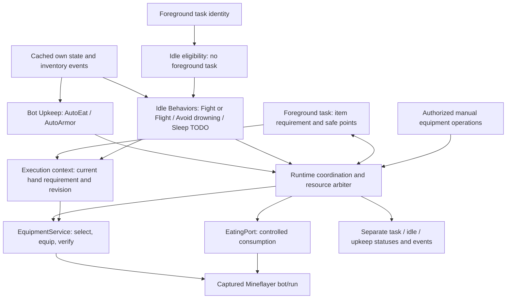

# Bot Upkeep and Idle Behaviors

Status: **revised proposal; documentation only**, 2026-11-04. This document defines the target architecture. It does not implement the migration, auto-armor toggle, or during-task eating. Current runtime behavior is described in [IDLE_BEHAVIORS.md](IDLE_BEHAVIORS.md); equipment details are developed in [EQUIPMENT_DESIGN.md](EQUIPMENT_DESIGN.md).

## 1. Two coexisting modules with distinct missions

**Idle Behaviors** perform optional actions only when no foreground gameplay task exists. **Bot Upkeep** maintains the bot's food and armor whether or not a foreground task exists. They coexist as separate modules with separate settings and feature ownership, sharing runtime coordination utilities rather than duplicating features.

| Feature | Sole owner | Eligibility | Scope/status |
| --- | --- | --- | --- |
| Fight or flight / Self-defense | Idle Behaviors | No foreground task | Existing opt-in behavior; retain its fixed response duration and current targeting policy |
| Avoid drowning | Idle Behaviors | No foreground task | Planned idle behavior; movement must remain bounded to the observed world and yield to a new task |
| Sleep | Idle Behaviors | No foreground task | **TODO — no detailed design or implementation in this scope** |
| Auto-eat | Bot Upkeep | During or outside tasks, subject to resource handoff | Migrate from the current idle controller; exactly one automatic food policy/executor |
| Auto-armor | Bot Upkeep | During or outside tasks, subject to inventory ownership | Initial armor scope is head, torso, legs and feet |

**Only auto-eat and auto-armor are upkeep features in this proposal.** Equipment reconciliation, condition observation and lifecycle logging are supporting infrastructure for those two features, not additional selectable upkeep features. The previous broader candidate catalog is discarded; it is not a future delivery backlog.

A foreground task temporarily yielding resources to upkeep remains the active task. It does not become idle, so yielding does not enable Fight/Flight, Avoid drowning or Sleep. Avoid drowning must not steal movement from an active task, even if that task is paused for a meal. If already active while idle, it must drain its movement operation before a newly requested task acquires control. This classification does not add an active-task drowning rescue guarantee.

Outside foreground tasks, an idle behavior and upkeep may both be eligible. They can overlap only when their resource claims are compatible: for example, ordinary armor replacement can accompany an idle movement behavior, while eating and idle melee must negotiate hand/use ownership. Neither module calls the other's feature code; both use the shared coordination boundary.

## 2. Current implementation and migration boundary

Today, `IdleBehaviors` handles auto-eat and Self-defense with idle-only eligibility. Protect uses a read-only held-weapon readiness port. Attack selects a weapon itself; excavation uses the tool plugin. Armor is equipped at spawn and by the armor plugin's collection callback. There is no unified writer for all these inventory operations.

The proposed change will:

1. Move automatic food eligibility, preferences, assessment and execution composition into Bot Upkeep. Reuse the existing food adapter initially; remove its scheduling from `IdleBehaviors` so two loops cannot eat independently.
2. Put all automatic armor decisions behind the AutoArmor upkeep module and the shared equipment executor, including spawn/collection-driven reconciliation. Its toggle must govern every automatic armor path.
3. Retain Self-defense in Idle Behaviors. Place Avoid drowning there when implemented. Keep Sleep explicitly TODO.
4. Establish the same hand-requirement and yield contract for every foreground task before advertising during-task food support.

This is a runtime refactor, not a cloud service or new gameplay scheduler. BotSession composes the modules; transport adapters only validate configuration, authenticate deployment access, and deliver snapshots/events. Minecraft role authorization remains independent: automatic upkeep and idle behaviors have no requester and do not perform a gameplay RBAC check. Settings still require authorized deployment access.

## 3. Do the libraries meet the requirements out of the box?

**No. Both food and armor need an application coordination layer.** Libraries provide useful low-level selection/equipment behavior; they do not know Kanabot's active task, its desired item, or resource ownership.

| Library | Useful capability | Missing for this design | Required Kanabot layer |
| --- | --- | --- | --- |
| `mineflayer-auto-eat` 5.0.3 | Food ranking, food equip/consumption; hunger-related options | Task safe points, resource arbitration, current task item requirement, confirmed restoration of the best required tool; robust lifecycle cancellation | Food policy in Upkeep, a controlled EatingPort adapter, and shared EquipmentService reconciliation |
| `mineflayer-armor-manager` 2.0.1 | Armor candidate comparison and `equipAll()` | A comprehensive automatic on/off gate, coordination with other inventory operations, run cancellation, task-aware transactions and desired-item verification | AutoArmor policy/selector plus the shared serialized equipment executor; its uncontrolled automatic writes must be removed from composition |

### Auto-eat: what the extra layer must do

The inspected plugin's autonomous mode attaches a physics-tick loop. `disableAuto()` removes that loop; it does not wait for an in-flight action. `returnToLastItem` means the item held before eating, not the current best tool required by a task, and the installed implementation does not await that restoration. Cancellation can occur during initial equip before the consumption wait exists. The current Kanabot adapter contains these lifecycle defects and keeps restoration awaited. [Auto-eat source](https://github.com/linkle69/mineflayer-auto-eat/blob/master/src/new.ts)

Keep autonomous mode disabled. Upkeep decides when a meal is appropriate; only the coordinator may invoke the adapter after required resources are yielded. For during-task eating, disable the plugin's own old-item restoration and avoid leaving a second adapter restoration path active. One EquipmentService must own post-meal reconciliation. The existing `AutoEatAdapter` therefore needs its current restoration responsibility moved behind that service rather than simply being relocated unchanged.

Food selection may continue using the plugin. Keep an `EatingPort` boundary so using documented Mineflayer equip/consume APIs later does not change task or upkeep policy. Replacing the library is not a prerequisite for the first implementation. Private compatibility hooks remain explicit, version-pinned and tested until they can be retired.

Using an offhand for food on supported versions may reduce main-hand switching, but it does not remove shared inventory/item-use conflicts or provide a general concurrency guarantee. The initial handoff must work correctly with ordinary main-hand eating.

### Auto-armor: what the extra layer must do

The installed armor plugin registers a collection handler that schedules equip work independently of `equipAll()`. It has no public comprehensive disable switch in the inspected entry point. Its selection also considers some offhand items, beyond the four armor slots approved here. Merely putting a lock around calls to `equipAll()` would leave autonomous writes outside the lock. [Armor plugin entry point](https://github.com/G07cha/MineflayerArmorManager/blob/master/src/index.ts)

Preferred implementation: stop loading its autonomous entry point once the replacement is ready, and implement a small armor selector and executor under EquipmentService using Mineflayer's supported equip calls. Existing plugin comparison logic can inform the selector; do not depend on undocumented internal imports as a stable public API. Removing/replacing the dependency is an implementation decision to review separately; this document changes no dependencies.

AutoArmor observes inventory/equipment changes, proposes one replacement when beneficial, obtains inventory ownership, revalidates item identity/current slot and preferences, awaits equip, and verifies the resulting armor slot. Head/torso/legs/feet are eligible; offhand management is outside this feature. Do not globally remove plugin listeners after injection to approximate disabling it. Manual armor changes enter the same executor and can establish an explicit override so automatic armor does not instantly undo them.

An ordinary armor-slot action does not need movement or look. Its resource claims must still account for the actual source slot: moving a currently held or otherwise leased item also affects that hand. Exclude items reserved by the active task’s specific-item requirement; if source/destination ownership conflicts, defer or obtain the additional lease and reconcile the current hand requirement. Do not repeatedly equip and then restore the same reserved item. All armor actions share inventory transactions with food and task tools. Mineflayer's equip implementation handles a specific item slot, and hand equip may switch hotbar selection or move inventory items. That is why compatible movement can continue while inventory writers remain serialized. [Equip implementation](https://github.com/PrismarineJS/mineflayer/blob/master/lib/plugins/simple_inventory.js)

## 4. Small shared runtime architecture



Use ordinary TypeScript components inside each bot runtime. A **small cooperative coordinator** deduplicates requests, negotiates safe points and grants resource bundles. It does not decide combat tactics, task permissions or the best mining tool. EquipmentService does not decide when the bot is hungry. Food code does not import any task class.

| Component | Responsibility |
| --- | --- |
| IdleBehaviorController | Idle-only eligibility and idle behavior lifecycles; no automatic food or armor policy |
| UpkeepCoordinator | Only AutoEat/AutoArmor eligibility, pending intents, fairness, backoff and lifecycle |
| ResourceArbiter | Shared ownership for foreground tasks, idle behaviors, upkeep and manual operations |
| ExecutionContext | Owner/run/task generation, phase and current declarative hand requirement |
| EquipmentService | Resolve current requirement, select/validate an item, serialize inventory mutation, verify readiness |
| EatingPort | One tracked food-use operation and cancellation; no independent loadout restoration policy |
| Foreground task adapter | Publish item requirements, acknowledge yields, resume from fresh task state |

Initially allow at most one mutating upkeep action in flight. Maintain one pending intent per upkeep feature; reassess it before execution. This is enough coordination for two features without a workflow engine, durable jobs, a broker or a distributed scheduler. Shared helpers do not imply overlapping feature ownership.

## 5. A generic item requirement for all tasks

The task must declare **what it needs to carry**, independently of whichever item is physically held at this instant. Store that requirement in ExecutionContext; never infer task intent from `heldItem` after food has replaced it.

An illustrative contract:

```typescript
type HandRequirement =
  | { kind: 'best-tool'; policy: string; context: ToolContext; constraints: ToolConstraints }
  | { kind: 'specific-item'; selector: ItemSelector }
  | { kind: 'empty' }
  | { kind: 'unrestricted' };

interface EquipmentIntent {
  ownerId: string;
  runId: string;
  taskGeneration: number;
  revision: number;
  phase: string;
  mainHand: HandRequirement;
}

interface TaskEquipmentPort {
  publish(intent: EquipmentIntent): void;
  clear(ownerId: string, taskGeneration: number): void;
}
```

These are design shapes, not new wire types. `ToolContext` contains serializable task facts such as the current block position/type or melee target traits, not a live task object. `ItemSelector` identifies the intended item under supported-version rules, not only an item type. `ToolConstraints` can represent task requirements such as harvest capability or excluded items.

Examples illustrate the contract, not additional upkeep features:

| Task/phase | Published requirement | After eating |
| --- | --- | --- |
| Protect or Attack combat | Best supported melee item under the task's combat policy | Re-select the eligible weapon from current inventory and verify it before combat resumes |
| Excavation at a block | Best tool satisfying the current block/harvest policy | Revalidate the block; resolve its tool requirement before digging |
| A future task needing a particular item | Specific item selector | Restore that requirement, not an arbitrary higher-ranked weapon |
| A task requiring an empty hand | Empty | Establish an empty hand through a non-destructive executor before resuming; block if it would require dropping an item |
| Follow with no hand requirement | Unrestricted | Preserve the prior held item when safely available; never choose a weapon just because eating ended |

A new task implements the shared requirement/yield contract, rather than adding a branch to AutoEat. If a new task needs a new selection policy, register its resolver with EquipmentService; food code stays unchanged. Requirements can change between task phases and their revisions prevent stale completion callbacks from restoring a previous phase's tool.

Enforce this at the task-runner boundary: every task declares a requirement, including an explicit `unrestricted` requirement. Only tasks that also implement safe handoff/resume may advertise during-task eating support. Legacy or unsupported tasks defer eating and report the reason until migrated. Type declarations alone do not stop raw Mineflayer calls; migrating and testing every inventory writer is part of implementation.

The executor must also account for low-level API side effects. In the installed Mineflayer implementation, unequipping a hand can drop items when no suitable space exists. An empty-hand requirement therefore needs a checked non-destructive plan; it must fail/defer rather than call a drop-capable fallback silently. [Hand unequip implementation](https://github.com/PrismarineJS/mineflayer/blob/master/lib/plugins/simple_inventory.js)

There is no universal definition of “best.” The task selects the applicable policy; a pure resolver compares available supported tools using appropriate effectiveness, durability, enchantments and stable tie-breaking. It does not interpret player roles. Specific-item and empty-hand requirements must not be converted into generic best-weapon selection. Existing tool-selection libraries can be adapters behind the resolver, but must not mutate equipment independently.

## 6. The post-meal guarantee, precisely

**A task must not execute hand-dependent work until its current hand requirement is satisfied and verified.** Enabling AutoEat must not leave it fighting with food, digging with the former block's tool, or continuing while restoration is still pending.

Main-hand eating does temporarily replace the desired item. It is physically impossible to promise that the same hand continuously holds a sword while holding food. The guarantee is a bounded, coordinated temporary override, followed by verified restoration/reselection **before conflicting task work resumes**. Non-conflicting task activity can continue when safe.

The generic transaction is:

1. **Assess:** AutoEat proposes a meal based on own hunger/health and available food. Its request records the observed revision and expiration, not a permanently chosen inventory slot.
2. **Negotiate:** obtain a safe-point yield for the conflicting resources. Keep the task identity active and its observers alive. Drain pending tool/combat/use operations; do not start eating on an acknowledgement that merely means “stop requested.”
3. **Temporarily use food:** under exclusive hand/use/inventory ownership, revalidate food and task/run generations, equip and consume through EatingPort. Keep the ownership until all owned work settles, even on error or cancellation.
4. **Refresh intent:** read the authoritative current ExecutionContext after the meal attempt. Ask the foreground adapter to refresh its context if observations changed while it was suspended. A removed block or dead target may require a new phase/requirement; do not blindly replay the earlier one.
5. **Reconcile:** EquipmentService resolves the current requirement against current inventory, equips the selected item, and confirms held-item readiness. It compares the intent revision after each asynchronous boundary. A superseded revision invalidates the result and causes bounded replanning, not indefinite retrying.
6. **Resume:** return a readiness acknowledgement tied to the same run, task generation and intent revision. Resume hand-dependent work only on that acknowledgement. Recompute navigation/combat intent from current state rather than replaying an old plugin goal.

Run this reconciliation after **every** meal outcome, including timeout, missing food after a slot change, or cancellation while a task remains active. An unsuccessful meal can still have changed the held item. A late plugin callback must not restore gear after ownership has passed to another action.

If the required item is gone/broken or no eligible tool exists, report a blocked/degraded outcome. The foreground task decides whether a documented fallback is allowed or whether to wait/stop. The food module must not silently choose bare hands, discard an item, or change the task's desired-item policy. If the task ended or Stop invalidated it, do not resume it or restore its obsolete requirement. A new task/manual override uses a new generation or revision and wins reconciliation under normal execution policy.

When no foreground task exists, use the active idle behavior's requirement, if any; otherwise preserve the prior valid held item as a fallback. Food restoration must still respect a new task arriving during an idle meal. Idle Fight/Flight's weapon use is not a separate automatic weapon upkeep feature.

### Why “restore the previous item” is insufficient

The previous item might have broken, moved slots, been superseded by a better available tool, or belonged to a different phase/task. EquipmentService uses current slot/revision and version-aware comparison; item type alone is inadequate. Stack IDs where available, item metadata/components, and inventory revisions can help validate identity, but there is no universal permanent Item identity. Relevant fields include `durabilityUsed`, `maxDurability`, `enchants`, and `Item.equal`. [Prismarine Item API](https://github.com/PrismarineJS/prismarine-item/blob/master/index.d.ts)

The current Protect read-only equipment placeholder cannot provide this guarantee. Implementing the shared resolver/executor from [EQUIPMENT_DESIGN.md](EQUIPMENT_DESIGN.md), and moving Attack/tool mutations through it, are prerequisites. This is supporting infrastructure for task correctness, not an additional upkeep feature.

## 7. Eating handoff diagram

```mermaid
sequenceDiagram
    participant U as AutoEat upkeep
    participant C as Runtime coordinator
    participant T as Any foreground task
    participant E as EquipmentService / ExecutionContext
    participant F as EatingPort
    U->>C: Propose meal
    C->>T: Request yield of conflicting resources
    T->>T: Reach safe point; drain owned operations
    T-->>C: Yield confirmed; task remains active
    C->>F: Grant food-use bundle and execute
    F-->>C: Meal attempt settled
    C->>T: Refresh current phase/requirement if needed
    T->>E: Publish current item requirement revision
    C->>E: Reconcile current authoritative requirement
    E->>E: Select current eligible item, equip, verify revision and hand
    alt Requirement satisfied
        E-->>C: Readiness for current generation/revision
        C->>T: Resume conflicting work
    else Required item unavailable or state uncertain
        E-->>C: Blocked/degraded with reason
        C->>T: Apply task-defined fallback or remain suspended
    end
```

For Protect/Attack, draining includes scoped combat startup/stop and any pending look/attack continuation. A PvP stop alone does not prove every callback is quiescent; adapter compatibility must establish this before concurrent item use is enabled. For excavation, yield between blocks or after active tool/dig operations are safely drained, then revalidate the next block. For Follow, movement may continue if it needs no conflicting item interaction and its movement owner confirms the current segment is safe for consumption. No per-task special case belongs in AutoEat.

## 8. Resource coordination and minimal interference

The shared arbiter grants complete required bundles atomically. Pending requests hold no partial leases, preventing a feature from keeping inventory while waiting for a task to release item use. Initial resource categories are inventory mutation, main hand, offhand, item use, movement and look. Claim only what an operation actually uses; ordinary AutoArmor transactions acquire inventory ownership, adding hand ownership only if the source slot requires it. Four armor destinations do not imply a permission to move a task-reserved item, or a need to stop movement.

| Combination | Coordination policy |
| --- | --- |
| Follow + AutoArmor | Continue movement; serialize the armor inventory transaction |
| Follow + AutoEat | Keep compatible walking when safe; defer or briefly yield movement for conflicting interactions/unsafe segments |
| Protect/Attack + AutoEat | Yield combat/use resources; reconcile the current weapon requirement before resuming |
| Excavation + AutoEat | Prefer a checkpoint between blocks; re-evaluate the next tool requirement |
| Excavation + AutoArmor | Wait for the relevant inventory transaction; unrelated movement need not stop |
| Idle Fight/Flight or Avoid drowning + upkeep | Only eligible without a foreground task; use the same resource negotiation for conflicts |
| Open container/manual equipment operation + upkeep | Respect current window and inventory ownership; defer rather than close the foreground window |

One mutating upkeep action at a time keeps the first implementation grounded. Routine fairness prevents repeated armor improvements starving food. Coalesce health/inventory events and keep one pending intent per upkeep feature; reassess stale requests. No physics-tick inventory ranking loop is required. A slow reconciliation around three seconds plus debounced events is a starting point to measure, not a gameplay guarantee.

Upkeep is independent of dashboard visibility and uses cached runtime state. The existing opt-in three-second roster broadcast remains separately lazy. Repeated missing-food/gear reports use backoff and rate limiting. Do not treat logging/condition observation as extra upkeep features.

A yielding task retains its task slot, owned identity and appropriate observers. Pause active-work watchdogs while legitimately suspended, with a separate suspension deadline. Attribute path/operation results to their run and attempt, so upkeep's goal cleanup cannot masquerade as a new task path failure. Preserve role-edit semantics: role changes do not cancel a running task or trigger new automatic RBAC checks.

## 9. AutoArmor behavior

AutoArmor only manages head, torso, legs and feet, based on inventory/equipment events and a bounded reconciliation check. It proposes a beneficial replacement, revalidates the actual item at execution time, awaits the shared equip executor and verifies the destination slot. Ranking must be documented for supported versions; material rank alone is not a promise of optimal armor across enchantments or custom servers.

Every automatic armor path must obey its toggle, including startup and collection. When off, no automatic armor mutation may occur; manual authorized actions remain available. When enabled during Follow, an armor transaction should not clear the pathfinder goal, change the desired main-hand requirement, or stop movement merely to equip a helmet.

Manual slot overrides need a clear lifetime or explicit release so AutoArmor does not immediately undo an intentional removal. These overrides are equipment-control state, not new gameplay roles. Inventory failure/uncertainty keeps conflicting mutations blocked until reconciled or the run is retired; do not retry continuously or silently toss displaced items.

## 10. Lifecycle and failure ownership

Stop, feature disable, bot death/end/dimension replacement, startup failure and task replacement invalidate the applicable generation before awaiting cleanup. Cancel pending assessments, handoff requests, reconciliation/debounce/retry timers and stale intents. Remove only owned listeners by their original references.

Keep completion listeners/deadlines necessary to settle in-flight operations alive. Drain captured-bot equip/consume/combat/dig work before releasing leases. A cancellation signal or outer timeout is not proof that a server action was canceled. Mineflayer exposes item-use completion and release methods, but the application still owns its lifecycle guarantee. [Inventory implementation](https://github.com/PrismarineJS/mineflayer/blob/master/lib/plugins/inventory.js)

Reconcile only the same live run's current winning requirement under the required leases. Do not perform obsolete restoration after a new controller acquires ownership. Publish one bounded outcome; cleanup failure stays visible and blocks conflicting execution. Retirement remains a recovery path. Spent food is not refunded and an uncertain consumption action must not be replayed blindly after a worker restart.

Disabling AutoEat during a meal cancels/drains it and completes any necessary current-task hand reconciliation before release. Disabling AutoArmor prevents new proposals and drains any existing equip transaction. Stopping the foreground task must not resume it via a meal completion callback; after cleanup, enabled upkeep can later operate outside tasks according to its normal backoff. Browser disconnection only detaches observation.

## 11. UI, settings and deployment

The proposed UI has two distinct sections:

- **Idle Behaviors:** Self-defense toggle, Fight/Flight and response duration; Avoid drowning when implemented; Sleep labeled **TODO** and not presented as working.
- **Bot Upkeep:** Auto-eat and Auto-armor toggles. No other upkeep controls are included in this scope.

Move the current auto-eat preference into upkeep without changing its saved value or leaving an idle copy active. New bots can default both upkeep features off. Existing deployments' implicit automatic armor behavior needs an explicit upgrade mapping (preserve it as enabled for existing definitions, then allow opt-out), rather than silently changing their behavior. The current memory-only runtime has no durable migration yet; document the mapping when persistence is introduced.

Keep foreground task status, idle activity and upkeep activity separate. Expose simple explanations such as eating, equipping armor, waiting for a task safe point, restoring the task's tool, missing food, required item unavailable and cleanup pending. Logs record material starts/outcomes/transitions with severity, not every assessment.

Preferences belong to the bot/session and continue without viewers. Authorized dashboard adapters configure them; runtime modules do not import transport or React. Future cloud bot definitions persist preferences and protected manual overrides as appropriate, never active promises, locks or Item objects. Each bot worker owns its own coordination state; these actions add no remote round trip to the game loop.

## 12. Focused delivery and acceptance

1. Establish the shared ExecutionContext item requirement, resource ownership and yield/resume contract. Migrate direct task/manual item writers and resolve the excavation cancellation prerequisites tracked in [KNOWN_ISSUES.md](KNOWN_ISSUES.md).
2. Split module ownership: keep idle features in Idle Behaviors, move food to Bot Upkeep, and replace uncontrolled automatic armor composition with toggle-controlled AutoArmor. Do not enable both old and new food/armor loops during migration.
3. Deliver AutoArmor during compatible movement and AutoEat during Follow, then integrate Protect, Attack and excavation through the same contract. A task without the contract explicitly defers upkeep; completing this scope requires migrating all current foreground tasks, not indefinitely claiming full support from Follow alone.
4. Verify the generic contract with an additional test task that requires a particular item and another phase that requires an empty hand. This proves AutoEat does not branch on current task names. Keep Avoid drowning on the idle track; Sleep remains TODO. No other candidates are part of delivery.

Required tests include: Idle Behaviors remain ineligible throughout upkeep suspension of a foreground task; no duplicate food/armor loops; Fight/Flight and food ownership while idle; armor during Follow without movement resets; meal reconciliation for melee, changing excavation block, specific-item, empty-hand and unrestricted requirements; missing/broken/moved/replaced tools; new better eligible gear during a meal; intent revision changes; manual overrides; failed or canceled meals; plugin callbacks completing late; unsupported task declaration; Stop/death/despawn/respawn at every await; resource-bundle fairness; listener/timer restoration; and settings/telemetry behavior without an attached browser.

Use installed-plugin fixtures and supported-version real-server scenarios to validate packet timing, inventory state, combat handoff and low-TPS behavior. No claim of best-tool restoration or safe concurrent mutation is complete until readiness is verified before task resumption. This document authorizes no runtime implementation on its own.
