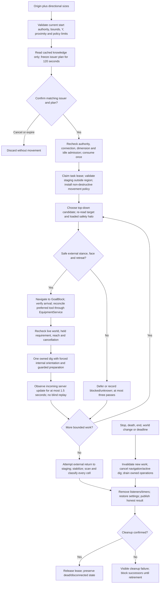
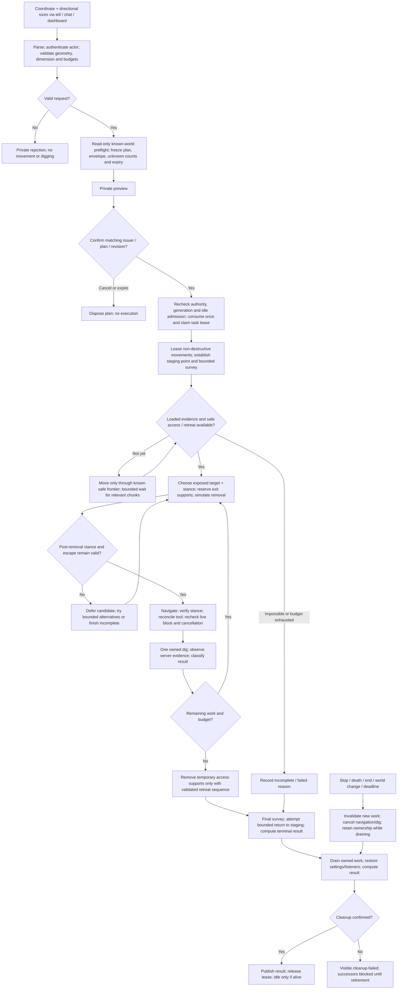
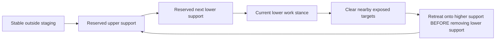

# Excavation: one coordinate plus directional sizes

Status: **first external-stance release implemented**, 2026-11-05. The approved implementation narrows the broader research below. Current behavior is in [spec.md](spec.md#excavate); lifecycle foundations remain in [TASK_LIFECYCLE.md](TASK_LIFECYCLE.md).

## Implemented first release

The current implementation supports coordinate-plus-sizes, read-only preview/confirmation, scoped cancellation and private feedback from public chat/tell/dashboard. Geometry and command parsing live in `backend/src/excavation/region.ts` and `commands.ts`; `service.ts` owns bounded issuer plans/history and admission, `world.ts` owns the external walkway model/ray coverage/server evidence, and `tasks/excavateTask.ts` owns sequential execution and cleanup. Shared JSON contracts live in `shared/excavationContracts.d.ts`; the existing EquipmentService owns hand selection/equipping and Upkeep coordination.

**Implemented limits:** 10,000 positions, 128 per axis, actual dimension height, preparation within 32 blocks of the box, flat full-block external walking within 32 blocks of staging, 4,096 graph cells, four stance candidates per target, three passes, 15-second navigation / 30-second dig / 15-minute job cancellation deadlines. No pit entry, access construction, automatic descent, progressive frontier survey, remote chunk loading or loot collection is implemented. Unknown/inaccessible cells remain incomplete. These limits deliberately replace the access-support/retreat-removal algorithm proposed in sections 6–7 for this release. They are product policy, not a claim that Mineflayer cannot perform deeper jobs.

A candidate requires a loaded nonhazardous target/halo, exposed full-block face with exact voxel ray coverage, supported external stance, modeled external retreat, current equipment and reach. Rechecks occur after navigation/equipment/upkeep and inside the existing dig look await. `dig(block, true, faceVector)` uses a **Vec3 face normal**, not a numeric face ID; it handles orientation internally. Movement uses a fresh constrained `Movements`, `GoalBlock` and actual-arrival checks. Original settings are restored only after owned work drains.

Equipment's `excavation` policy uses the connected version's `registry.materials[block.material]`, `block.canHarvest`, durability and digTime. It selects shovel/pickaxe/axe/other preferred tools rather than a hardcoded list of block names, refuses a missing preferred tool and permits bare hands only when there is no preferred material tool and hand harvesting is valid. No task-specific branch was added to food upkeep.

Incoming block packets provide attempt evidence; local optimistic world events do not. Missing evidence yields unverified work and is retained as unknown for later jobs on the captured connection, preventing a second job from blessing optimistic local air. This bounded conservative uncertainty ledger has no background listeners; fresh incoming updates during an active excavation or a fresh connection can restore knowledge. Full chunk receipts and passive re-observation of uncertain cells remain future work. Final stabilization is 250ms, followed by a scan. It detects ordinary observed rollback; later world changes remain possible.



The remaining sections preserve research and the broader proposed executor. References to progressive observation, reserved access supports or hypothetical terrain simulation **are not implemented guarantees**. Look at two corners remains the only future selection input. Installed-library/simulated regressions cover cancellation, non-destructive path generation, false arrival, geometry/authority, preferred tools, world changes, uncertain receipts and maximum mostly-air accounting. No live-server acceptance has been performed.

## 1. Release decision

The next release accepts **one explicit block coordinate and directional sizes**. Example:

```text
/tell mc_bot !dig from 120 64 -30 east 8 south 6 down 4
```

**Look at two corners** is reserved for a future release, feeding the same canonical region planner. No commands or selection adapters for it are included now. Bot/player-relative origins, arrow selection, support/marker selection, swing/stick tools and server-plugin bridges are discarded from this design. No AI interpretation, building supplies, loot-collection subsystem or cloud infrastructure is required.

The result is an inclusive axis-aligned cuboid. The executor removes accessible permitted blocks, preserves a known way out, and reports incomplete or unknown work honestly. It must not promise that every arbitrary cuboid can be fully cleared and exited without block placement. This is a consequence of geometry and the chosen no-placement policy, not a hard depth limit imposed by Mineflayer.

## 2. Methodology and evidence

The review compared the requested public documentation and example with the installed dependency implementations and current Kanabot command, equipment and task code. Installed baseline: Mineflayer 4.37.1, pathfinder 2.4.5, prismarine-world 3.7.0, prismarine-block 1.23.0; repository source baseline `1fe5cf8`. Upstream `master` describes current upstream behavior and is not a substitute for checking the installed npm artifact. The documentation site is a JavaScript-rendered API; its repository API Markdown was read as well.

Method:

1. Separate documented API capabilities, observed implementation details, product policies and unverified server behavior.
2. Derive geometry and execution invariants before choosing a traversal order.
3. Evaluate challenging cases: deep/narrow pits, buried targets, unloaded chunks, stale paths, server rejection, tool shortage and cancellation.
4. Prefer a small deterministic planner and the existing task/equipment coordinator over another autonomous digging controller.
5. Require installed-library regression fixtures and real-server acceptance for claims that mocks cannot establish.

Prior offline probes found: `goto()` can resolve an empty `noPath` result; a deliberately deferred internal look can permit digging after cancellation; and ignored-look digging registers active digging synchronously in the inspected implementation. The deferred-look probe **does not prove a normal network-triggered race with stock `dig(block, true)`**, whose forced rotation does not wait for gradual turning. No live Minecraft test was run. This revision adds source review and documentation checks, not gameplay evidence.

### API evidence map

| API / source | Actual use in this design | What it does not establish |
| --- | --- | --- |
| [Mineflayer dig API](https://prismarinejs.github.io/mineflayer/#/api?id=botdigblock-forcelook-digface), [repository reference](https://github.com/PrismarineJS/mineflayer/blob/master/docs/api.md#botdigblock-forcelook-digface) | `dig(block, true, face)` performs a dig with explicit instant orientation; `stopDigging()` interrupts active digging; `digTime(block)` supplies current held-tool timing. | No separate `lookAt()` prerequisite; no terrain planner, claim permissions, cancellation token or atomic world operation. |
| [Official digger example](https://github.com/PrismarineJS/mineflayer/blob/master/examples/digger.js) | Demonstrates direct `await bot.dig(target)` after obtaining/checking a block. | Digging underneath oneself and later building upward is not an escape strategy for this no-placement release. |
| [Installed-version digging source](https://github.com/PrismarineJS/mineflayer/blob/4.37.1/lib/plugins/digging.js) | Defines the actual startup/active-dig boundary and local optimistic completion behavior that our adapter must accommodate. | A resolved dig is not an authoritative server acknowledgement. `canDigBlock()` is not a comprehensive line-of-sight or hazard test. |
| [Pathfinder API](https://github.com/PrismarineJS/mineflayer-pathfinder), [README](https://github.com/PrismarineJS/mineflayer-pathfinder/blob/master/readme.md) | `Movements`, `getPathFromTo`, `goto`, `setGoal`, `stop`, path events and bounded search settings. | No globally optimal quarry plan, remote chunk fetch or prediction of a future excavated world. |
| [Goal implementations](https://github.com/PrismarineJS/mineflayer-pathfinder/blob/2.4.5/lib/goals.js) | Prefer `GoalBlock` for an application-validated standing cell. `GoalLookAtBlock` is an optional candidate generator; `GoalNear` alone is insufficient. | A proximity goal does not prove a usable stance/face, nor preservation of future access. |
| [Movement implementation](https://github.com/PrismarineJS/mineflayer-pathfinder/blob/2.4.5/lib/movements.js) | Disable navigation digging/placing, constrain drops and exclude unsafe cells. | These safeguards do not automatically govern direct `bot.dig()` calls. |
| [Navigation implementation](https://github.com/PrismarineJS/mineflayer-pathfinder/blob/2.4.5/index.js), [goto helper](https://github.com/PrismarineJS/mineflayer-pathfinder/blob/2.4.5/lib/goto.js) | Inspect path results, await actual movement and verify postconditions. Stop/drain the operation before releasing ownership. | Search timeout is not a wall-clock travel deadline; a resolved helper promise is not sufficient arrival evidence. |
| [Block/chunk implementation](https://github.com/PrismarineJS/mineflayer/blob/4.37.1/lib/plugins/blocks.js) | `blockAt`, loaded-column checks, `chunkColumnLoad`/`Unload`, block updates, and bounded waits. | `waitForChunksToLoad()` waits around the bot, not around an arbitrary target coordinate. |
| [World raycast implementation](https://github.com/PrismarineJS/prismarine-world/blob/master/src/worldsync.js) | Check candidate faces against cached collision shapes, after verifying coverage. | The native raycaster can pass missing data; unknown space cannot be treated as air. |

The API table is a use contract. Detailed behavior below is our proposed policy/algorithm, except where explicitly identified as a library fact. Public APIs are preferred; the server-observation adapter is the one narrow protocol-specific boundary.

## 3. Request syntax and player interaction

### 3.1 Grammar and geometry

```text
!dig from <x> <y> <z> [east N | west N] [south N | north N] [up N | down N]
```

Brackets and vertical bars above indicate grammar choices, not text to type. Direction/count pairs may appear in any order. Require at least one pair; omitted axes have size one. Coordinates are signed decimal integers; counts are positive decimal integers. Reject fractions, exponent/hex notation, repeated or contradictory axes, unexpected words and extra parameters. `!excavate` may remain an alias.

Minecraft axes are **east +X, west -X, up +Y, down -Y, south +Z, north -Z**. Sizes count blocks **including the origin**. For origin coordinate `a`, direction `s` in {-1,+1} and size `n`, the other endpoint is `a + s*(n-1)`. Normalize endpoints and multiply inclusive lengths, checking integer overflow before allocation. One starting block is meaningful; `east 1` does not add another block.

For `(120,64,-30)` and `east 8 south 6 down 4`, bounds are X `120..127`, Y `61..64`, Z `-30..-25`, volume **192**. `west 8 north 6 up 4` yields X `113..120`, Y `64..67`, Z `-35..-30`, also 192. Y is the actual starting block layer, not the player's feet or the bot's supporting block. Neither movement nor turning changes the region.

### 3.2 Conversation

```text
Player: /tell mc_bot !dig from 120 64 -30 east 8 south 6 down 4
Bot: Plan Q7B2: 8 east x 6 south x 4 down; 192 positions, overworld.
Bot: Bounds X 120..127, Y 61..64, Z -30..-25.
Bot: Observed: 160 solid, 8 air, 24 unknown. Access survey needed before digging.
Bot: Movement stays inside the shown survey envelope. No outside digging or placement.
Bot: !dig confirm Q7B2 to survey and execute; !dig cancel to discard. Expires in 120s.
Player: /tell mc_bot !dig confirm Q7B2
Bot: Task T41 accepted. Surveying access; no blocks removed yet.
Bot: Excavating layer Y64. 40 positions clear, 152 remaining.
Bot: Completed: 192 positions observed clear. Returned to staging point.
```

Counts are illustrative. Preview separates known/unknown positions, prospective access/escape strategy, envelope, estimated workload and hard limits. Confirmation authorizes bounded movement/survey plus permitted excavation; it does not assert that unknown terrain is safe. If survey discovers an obstruction requiring a larger region/envelope, stop and request a new plan, without expanding permission implicitly.

| Command | Behavior |
| --- | --- |
| `!dig help` | Show the coordinate-plus-sizes form and count convention. |
| `!dig preview` | Repeat the sender's latest frozen plan and evidence timestamps. |
| `!dig confirm <planId>` | Confirm that plan's exact bounds/policy/generation. |
| `!dig cancel` | Discard the sender's pending plan only. |
| `!dig status <taskId>` | Return phase, current layer, clear/unknown/remaining counts and reason. |
| `!dig stop <taskId>` | Cancel the initiating player's own excavation; Owner/deployment authority may cancel another according to authorization policy. |

These command forms are implemented in the bounded first release. Inbound whispers and public chat use the same exact parser; feedback defaults to bounded one-line private messages through the existing whisper helper, with no public fallback. Mirror them privately in the dashboard. Send acceptance, significant phase changes, progress at most every five seconds, and one terminal result.

Crew/Owner retain start permission. The initiating actor/task ID must be recorded by the backend because current Crew can start excavation but cannot use Owner-only general `!stop`. Own-excavation cancellation is a new explicit ownership policy, including after role demotion; it does not give Crew general control of other tasks. `!stop` retains its current policy.

The dashboard uses the same prepare/confirm service, with coordinate and named-size fields. For migration, old six-coordinate requests may normalize through the same factory as a compatibility adapter; they must not bypass confirmation. They are not a second selection workflow to extend. The first release updates the client/protocol together; legacy wire actions now prepare without starting execution.

## 4. Initial request to completion



Every loop has finite retry/deadline counters. The diagram's “try alternatives” path terminates when the candidate set is exhausted. Completion requires all requested positions observed clear **and** successful safe retirement of access supports/exit; interrupted work and uncertain cleanup never follow a success path. Stop does not launch an automatic return journey. Death/end cannot be overwritten by a late idle transition.

## 5. Distinguish real issues from assumptions

| Concern | Verified situation | Design consequence |
| --- | --- | --- |
| Maximum excavation size | Mineflayer digs one block at a time; no reviewed API defines a 10,000-block job maximum. That number is Kanabot policy. | Retain it initially for bounded work/memory, centralize configuration, and count the entire cuboid including air/unknown cells. Larger limits require load evidence, not a new API. |
| Blocks not visually rendered | The bot is not using the player's renderer. Occluded underground blocks may be available in received chunk sections. | A buried but known block is a navigation/exposure problem, not automatically an observation failure. |
| Chunks not received | `blockAt` may return null; arbitrary target chunks cannot be fetched by naming coordinates. Movement can cause the server to send more world data. | Classify unknown, progressively approach through safe loaded space and wait for relevant columns. Never skip unknown as cleared. |
| “Optimal” snake traversal | Static top-down serpentine order reduces walking on a flat accessible layer, but does not model destroyed support or future access. | Use it only as a tie-breaker within a safe frontier. Preserve retreat before minimizing travel. No claim of global optimality. |
| Digging below the bot | The official example demonstrates it, so it is not categorically unsupported. Its recovery uses building. | This release disallows placement and therefore needs a different exit strategy; digging current support is rejected unless an independently validated transition exists. Initially reject it. |
| Looking before digging | Explicit `lookAt()` is unnecessary; `dig` controls its own orientation or can ignore it. | Do not add a redundant look prerequisite. Orientation/visible-face restrictions are compatibility policy, verified on supported servers. |
| Reaching a block | Proximity and a pathfinder promise do not ensure a valid final stance or dig face. | Recheck goal, support, reach and chosen face after movement and food/equipment awaits. |
| Dig promise completion | Installed digging code updates local state optimistically. | Keep attempt completion distinct from incoming-server evidence; do not advertise a receipt or blind-retry unknown effects. |

## 6. World observation and unloaded targets

Maintain per-position knowledge: `unknown`, `known-solid`, `known-clear`, `attempt-pending`, `server-observed-clear`, or a bounded failure reason. A `null` read is not air. A chunk arriving may reveal buried blocks without any line of sight; a chunk unloading invalidates its evidence for future safety decisions.

Preview reads only cached data and does not move the bot. It can produce a **conditional plan** when some terrain is unknown, showing the upper-bound volume and movement envelope. It rejects an already known impossible/out-of-policy request. Confirmation starts a task-owned survey before destructive work.

Survey algorithm:

1. Record the current dimension/generation and a safe staging stance outside the removal region, or reachable without mutation. If none exists, reject access.
2. Identify missing columns intersecting target, approach and required safety halo. Vertical target cells are checked against current dimension bounds and received sections; do not mistake loaded columns for universally fresh/safe contents.
3. Select a reachable **known** frontier stance toward missing coverage inside the approved envelope. Pathfind without break/place. Do not route through unknown cells, including unknown floor/headroom.
4. Subscribe to exact chunk load/unload events before moving/waiting; re-read coverage after each event. Use an owned timeout. Recheck after subscribing to avoid missing an arrival. The convenience `waitForChunksToLoad()` is only for nearby readiness; it is not a target-region loader.
5. If coverage expands, continue. If no safe frontier, no new coverage or the survey budget expires, report `UNOBSERVED_REGION` / `NO_SAFE_APPROACH`. Do not excavate into an unknown neighbor hoping a chunk will arrive.

Server view distance, withheld chunks and inaccessible terrain may prevent progress. There is no assumed remote-chunk-query, teleport or force-load permission. Reads do not generate additional server queries. Explicit authorized movement naturally changes what the server sends. Rendering services are irrelevant to this execution path.

For large/partially known boxes, survey and excavation may progress in bounded observed sections, provided the current section's halo and retreat are known. Unknown distant cells remain outstanding; they never enter success counts. No section can waive the total volume or approved-envelope limits.

## 7. Excavation maneuver and escape preservation

### 7.1 Planner model

Treat the problem as sequential world modification, not just visiting coordinates. Maintain a bounded graph of **standing cells**: feet/head space, solid support, collision clearance and supported transitions. Initially support ordinary full-block walking, one-block ascent/descent and no parkour, swimming or uncontrolled falls. Non-full shapes may be conservatively excluded until their transition rules have fixtures.

The graph covers the active section, safety halo and approved approach/exit corridor, not an entire dimension. Pathfinder supplies actual current-world routes. A separate pure planner evaluates a hypothetical block-removal overlay for safety; never mutate `bot.world` to trick pathfinder into believing a future state exists. `getPathFromTo` does not itself provide a future-quarry simulator.

An active removal candidate must satisfy:

- Target is inside the requested box, observed and permitted by block policy.
- A currently reachable standing cell can reach an appropriate exposed face.
- Removing the target does not invalidate that standing cell's support/headroom, reserved access supports or modeled retreat.
- Under the hypothetical removal, there is still a known supported route from the operating stance to staging/exit, or a validated immediate successor stance with such a route.
- Required neighbors and route cells are known. No fluid/gravity/container/player-occupancy exclusion is violated.

These are conservative planning invariants, not a proof against arbitrary concurrent server changes. Revalidate immediately before each dig and invalidate plans on relevant block/chunk changes.

### 7.2 Order of work

1. Establish staging/exit before digging. Start with high exposed surfaces and approach from a stable boundary where possible.
2. Generate a small exposed frontier in the highest unfinished workable layer. Hidden blocks are deferred until approved neighboring removals expose them; do not attempt through a wall merely because distance is short.
3. Reserve supports forming an access spine/staircase where descending into the region is needed. Clear only authorized headroom around it. Pathfinder itself cannot mine the route.
4. Rank safe candidates lexicographically: preserve exit and reduce dependencies first, then higher layer/exposure, path cost, tool-change cost and deterministic serpentine tie-break. Only the best few candidates get expensive path searches.
5. Move to a validated stance, remove one block, observe changes and recompute affected candidates/graph nodes. Use the updated world before choosing the next target.
6. When ordinary material is cleared, retire reserved supports in a prevalidated **retreat sequence**: ascend/move to the next supported stance before removing the previous lower support from reach. Every step must preserve the remaining route out. Do not assume any arbitrary staircase can be removed this way.
7. If a safe retirement sequence cannot be found, retain the supports, exit if possible and report partial completion with their coordinates/count. Never label retained target blocks as complete.

### 7.3 Why an exit spine matters



This represents a dependency order, not a fixed staircase geometry. Support heights, headroom, reach and final removal must be checked for the actual box. A shallow patch may be clearable entirely from outside with no reserved spine. A broad deeper pit may admit a staged ramp. A deep one-cell shaft with no reachable side exit can be impossible to clear **and exit** without placement, despite having a small block count. Decline a known infeasible job before destructive work; if newly discovered world data makes it infeasible mid-task, leave a safe partial result.

Upward extents describe a box, not permission to undermine a roof. The same frontier/dependency rules apply; unobservable overhangs and gravity/fluid hazards can prevent execution. No universal “always top-down” or “always dig underneath yourself” maneuver is correct.

The first implementation may miss feasible solutions because its planner is conservative. Return `NO_SAFE_SEQUENCE` with remaining cells; do not confuse planner failure with a mathematical proof that excavation is impossible. This bounded heuristic is preferable to promising globally shortest movement on a changing world.

## 8. Movement, digging and effect ownership

### 8.1 Movement lease

Capture/restore movements, search radius, think/tick settings and any changed plugin settings. Configure non-destructive navigation with `canDig=false`, `allow1by1towers=false`, no scaffolding sources, placement exclusions, parkour disabled, bounded drops and no unlimited liquid drops. The explicit dig step is the only world-removal writer, entering the existing equipment lane. This avoids pathfinder's independent tool/equip/break/place path and keeps all mutations inside declared authority.

Use `getPathFromTo` with bounded search options for shortlisted current-world stances; consume its generator in scheduled slices. A `partial` search is unfinished, not arrival. Navigate to a selected `GoalBlock`, inspect `path_update` failures and validate actual arrival afterwards. `GoalLookAtBlock` can assist face-oriented candidate selection, but use conservative explicit reach/height and independent postconditions rather than trusting its default assumptions.

The installed `goto` helper's empty-path success behavior requires a scoped checked-navigation adapter. Do not patch the dependency globally. At return, verify target stance coordinates/tolerance, stable support and current route validity. Add a wall-clock travel/progress watchdog in addition to search timeout.

### 8.2 Dig API policy and cancellation

Default proposal: use explicit `bot.dig(block, true, face)` for a validated face, or `bot.dig(block, true)` where the tested default face suffices. No separate application-level `lookAt()` is required. Do not require `'ignore'` merely to avoid turning: that is an optional measured compatibility mode, and the inspected ignored-look branch bypasses custom-face setup. Calling with `false` would introduce gradual preparation that must be owned/drained; it is unnecessary for the baseline.

`canDigBlock` and current `digTime` are readiness inputs. Immediately before submission, re-read the block, cancellation, world identity, stance/face, support, tool intent revision and policy. After any equipment/food await, repeat those checks. Do not launch concurrent digs. A small `DigPort` owns the submitted operation and active cancellation; `stopDigging()` is not an AbortSignal parameter to `dig`.

Keep the conditional delayed-look probe as a regression requirement. Test stock forced look separately from intentionally delayed preparation; do not claim the fixture established normal network-stop timing. If asynchronous preparation remains capable of submitting after cancellation, the adapter must gate that submission or disable that mode before release. No broad interception of all protocol writes.

Cancel invalidates pending work synchronously, interrupts navigation/digging when active and drains every owned promise before successors. A ten-second cleanup warning does not mean work stopped. Already submitted instant digs cannot be undone. On emergency Stop, do not launch a new exit path automatically; report the last known position and allow explicit subsequent control after cleanup. Normal completion/partial failure may attempt a bounded safe retreat; death/end skips that movement.

### 8.3 Tools and block policy

Use EquipmentService intent/resolution for each current target, not a second tool plugin controller. Reconcile through the same inventory lane as upkeep. Estimates/ranking must account for current game mode, water/on-ground state and relevant enchantments; current heuristic assumptions are not universal optimality. Never discard inventory automatically. No suitable allowed tool, no empty hotbar when needed or capacity policy failure should yield a clear recoverable task result.

Dig-only behavior does not promise ore drops: bare hands may break a block without harvesting it. Show this in preview. Do not silently optimize for Fortune/Silk Touch or add chest collection behavior.

An explicit policy covers direct digging of containers/block entities, protected/undiggable blocks, occupied/support cells, nearby unknowns, falling material and liquid exposure. Pathfinder break policy does not cover explicit digs. Conservative exclusions are product safety choices; not every sand/fluid-adjacent block is physically impossible to remove. Unsupported situations are reported precisely instead of presented as library limitations.

## 9. Limits, observation confidence and results

### 9.1 Initial configurable budgets

These are proposed pilot defaults, not API limits or measured capacity guarantees. Centralize them in one policy object shared by admission, planning and execution.

| Budget | Initial proposal | Purpose |
| --- | --- | --- |
| Requested volume | 10,000 inclusive positions | Existing bounded job policy; includes unknown/air and any reserved supports inside the box. |
| Maximum axis length | 128 blocks | Bounds long thin jobs and planner geometry independently of volume. |
| World Y | Current dimension `minY <= y < minY+height` | Dimension data, not hardcoded Overworld bounds. Reject if unavailable/unvalidated. |
| Survey/approach envelope | Box plus explicitly previewed bounded corridor/halo; initial approach at most 128 blocks | Movement authority and discoverability; never expands silently. |
| Local path search | 64-block search radius per leg, 1.5s compute budget, 10ms slices | Not a global excavation radius. Longer approved travel uses observable successive legs. |
| Planner graph / shortlist | 20,000 standing nodes, 12 candidate path searches per planning cycle | Prevent combinatorial search. Exhaustion reports a planning limit. |
| Observation wait | 10s per relevant frontier wait; 60s total initial survey | No infinite chunk waiting. Late events cannot revive expired work. |
| Travel | 30s leg deadline/progress watchdog | Search completion does not cap walking time. |
| Digging | Predicted-time allowance plus margin, maximum 60s per block | Reject a too-slow tool before submission; drain on runtime timeout. Exact multiplier determined by latency fixtures. |
| Entire task | 30 minutes wall clock, including waits | A volume under the cap does not promise completion within time. Show estimated workload separately. |
| Drafts | One per issuer, 16 per bot, 120s expiry | Bounded local memory and stale confirmation control. |

Do not automatically split an oversized request into several jobs to bypass admission. Tool/material changes affect runtime and estimates; a slow 10,000-block region may legitimately end partial under the duration cap. Limits should change only with benchmark/acceptance evidence.

### 9.2 Server evidence

The installed dig implementation can resolve through an optimistic local air update. `blockUpdate` alone mixes local and incoming-world changes. Therefore track `attemptsCompleted` separately from observed clearance. A narrow read-only server-observation adapter must distinguish incoming block-change/batch/chunk data for supported versions, associate it with captured dimension/generation and decode it using the installed protocol rules. Register before sending the dig; do not assume listener order or rely solely on the current cache value after the packet has been handled.

Speculative local air must not be used as newly traversable space or as proof that an access obstruction has gone; wait for the required incoming evidence before updating the usable stance graph. Incoming clear state is evidence of observed clearance, not proof that the bot caused it or that it remains empty forever. Protection/rollback updates invalidate clearance. If no server-origin evidence is received, use a bounded observation deadline and mark unverified; do not force chunk reloads or assume another client's updates will arrive. This may conservatively report partial on a server that suppresses redundant updates. Live compatibility testing must establish supported expectations; loosening confidence must not turn unknown into confirmed success.

Before success, scan the entire bounded region using current evidence/loaded coverage, checking restored/filled cells and reserved supports. For cells loaded from the server as air and never modified locally, no dig receipt is needed; keep the incoming-chunk provenance and invalidate it on changes/unload. Missing coverage is still unknown. A bounded final stabilization window detects ordinary rollback but is not permanent-world assurance.

### 9.3 Outcomes and accounting

Each requested position has one final classification: `observedClear`, `blocked`, `failed`, `unverified`, or `unvisited`; their sum equals volume. Attempt counts and initially-clear counts are separate non-additive metrics. Store bounded reason counts/examples rather than unbounded per-tick logs. Runtime detail may track positions for this <=10,000-cell job; wire snapshots stay compact.

- **Completed:** all requested cells observed clear, temporary supports removed, final exit/staging reached and cleanup confirmed.
- **Partial:** some useful work/known clearance, with blocked/failed/unknown/unvisited cells, retained supports, or unsuccessful normal return. State the cause and position.
- **Failed:** no viable execution or a terminal setup/runtime fault; include observed work if any so failure does not imply zero effects.
- **Stopped:** user/lifecycle/budget cancellation, with actual counters and remaining work. No automatic resume/replay.
- **Cleanup-failed:** ownership is unconfirmed; keep the coordinator gate and visible recovery instructions. Do not publish a successful release.

A return-path failure after all blocks clear is not full task completion: distinguish region completion from exit outcome. Death/disconnect may leave the bot somewhere unsafe; the design cannot guarantee recovery after external terrain changes or connection loss. A fresh request re-inspects the current world; it does not replay historical dig attempts.

## 10. Architecture, authorization and contract changes

Reuse existing BotCommandService, TaskCoordinator and EquipmentService. Proposed focused responsibilities:

| Module boundary | Responsibility |
| --- | --- |
| Minecraft/dashboard adapters | Exact parsing/channel attribution and private feedback. Inbound tell must be wired to dispatch; avoid duplicate public/private pattern handling. |
| Region/plan factory | Strict geometry, canonical bounds, limits, frozen policy, preview revision and expiry. Pure arithmetic is reusable for future look selection. |
| Excavation application service | Actor-scoped prepare/confirm/status/stop; read-only preflight, serialized admission and task context. |
| World observation adapter | Known/unknown state, incoming evidence, chunk events and bounded waits. No movement authority. |
| Excavation planner | Frontier, stance graph, reservations, counterfactual removal and retreat dependencies. No sockets/React. |
| ExcavateTask and narrow movement/dig ports | Execute one action at a time, own asynchronous work, coordinate upkeep, cancel/drain and publish progress/results. |

Split these responsibilities as needed in the existing excavation/task directories; do not create a general plugin registry or distributed scheduler just for this feature. Mineflayer objects remain local to the runtime. Existing task modules continue to own their game rules; composition belongs in BotSession/application services.

The command context carries a backend-derived initiating actor, bot ID, task ID, connection generation and dimension. Public IDs alone confer no authority. Current Minecraft username trust limits remain as documented in [BOT_OWNERSHIP_DESIGN.md](BOT_OWNERSHIP_DESIGN.md); UUID observations do not turn offline names into account authentication.

Confirmation rechecks current start permission and plan/role revision, world generation, expiry and task availability. If preflight awaits, repeat checks afterwards, then consume-and-claim synchronously under local per-bot serialization. Busy admission returns a retry explanation without losing the valid draft. Once accepted, duplicate confirmation returns the known task result/status; expired/evicted IDs are rejected rather than reconstructed from a client copy. Role edits do not preempt an already accepted task. Own cancellation remains available to the recorded initiator.

Death, retirement, world/connection replacement and expiry invalidate drafts and dispose observers. Browser loss only detaches viewing. Plans/outcomes remain bounded and in memory; backend restart invalidates them. Durable recovery stays future architecture work, with no database/remote calls in the game reaction loop.

Proposed versioned shared JSON contracts:

```text
PrepareExcavation: origin {x,y,z}, directionalSizes
ExcavationPlan: schemaVersion, planId, revision, botId, generation, dimension,
                bounds, dimensions, volume, envelope, policy, knownCounts,
                readiness, warnings, observedAt, expiresAt
ConfirmExcavation: planId, revision
ExcavationUpdate: taskId, phase, layer, positionsChecked, attemptsCompleted,
                  observedClear, blocked, failed, unverified, unvisited,
                  returnOutcome, reasonCounts, boundedExamples
```

Use runtime validation and ISO timestamps. Actor authority comes from the adapter, not payload fields. Update frontend/backend together and explicitly migrate existing `ExcavationSummary` fields; no new wire events exist until implemented. Add only the bounded progress needed for replaceable UI/telemetry; retain current transport-independent execution.

## 11. Development sequence and release gates

1. **Geometry and contracts:** strict parser/factory, count semantics, dimension and policy validation, immutable prepare/confirm records, actor/task context and scoped cancellation. No world mutation in preparation.
2. **Library boundary fixtures:** real installed digging/pathfinder code with simulated world/client; movement cannot break/place/equip independently, navigation postconditions, stock and delayed preparation cancellation, incoming-versus-local evidence. Close gaps before a destructive end-to-end release.
3. **Planner:** first flat/boundary-accessible jobs; then reserved access/retreat planning within the same command version. Both share the invariants. A first vertical slice may report `NO_SAFE_SEQUENCE` on harder geometry, but must never silently use unsafe snake order.
4. **Progressive observation:** chunk boundaries, missing columns, bounded frontier survey, safe unknown handling, unload invalidation and final coverage.
5. **End-to-end feature:** private/public/dashboard parity, preview/confirmation, upkeep handoff, progress and honest exit/results. No automatic task queue/preemption.
6. **Acceptance and capacity:** disposable supported-version server tests, real protection/rollback/latency and chunk behavior, then workloads up to the configured cap. Record CPU, memory, event-loop delay, command/Stop latency, search count and total duration. Tune defaults from evidence.

Required test matrix:

| Area | Required scenarios / acceptance |
| --- | --- |
| Geometry | Six directions, negative coordinates, omitted axes, size one, reversed signed extents, invalid numeric forms, contradictory axes, exact/over volume cap, Y bounds and overflow before allocation. |
| Authorization | Crew start + own stop, Owner/deployment controls, role edits before confirmation, another issuer's IDs, replay/expiry/generation change, busy admission and browser disconnect. |
| Stance/ordering | Flat 8x6 patch, multi-layer 8x6x4, higher box, narrow deep shaft, bot inside box, external platform, stair reservation/removal, blocked final retreat, no safe sequence, and no current-support dig. Check region-clear and exit outcomes separately. |
| Observability | Buried loaded blocks, missing far columns, natural arrivals on approach, server low view distance, delayed/no arrivals, unload during travel/dig/final scan, unknown halo and ray gaps. No unknown-to-air conversion or forced target chunk query. |
| Dynamic world | Water/gravel exposure, containers, occupied cells, another player edits the ramp, protected block restores, transient rollback and stale generation updates. Replan conservatively and bound retries. |
| API integration | Empty noPath resolution, false arrival, search/travel timeout, shape/eye/reach mismatch, dig rejection, optimistic local completion without server evidence, tool loss, food during each phase, full hotbar/inventory and slow-hand timing. |
| Cleanup | Stop before/during preparation, navigation, equipment, active dig and server wait; death/end; late completion cannot restart motion or release a failed lease; listener/timer/settings baseline restored after repeated jobs. |
| Load | Maximum-policy jobs with mostly air, mostly solid, mixed failures and no usable routes. Bound scan batches/graph/search work; do not block emergency command handling. |

Live acceptance selects concrete Minecraft versions/server configurations; the installed package version alone is not a compatibility matrix. No universal anti-cheat, modded-server, safe-fluid or successful-escape claim follows from mocks. **Look at two corners remains the only planned future input release**; it will produce the same validated origin/bounds representation and will not replace this executor.

## 12. Relation to existing review findings

The earlier review's identifiers remain useful for issue links: **EX-01** navigation mutation ownership; **EX-02** conditional delayed-preparation cancellation (ordinary forced-look race unverified); **EX-03** optimistic completion evidence. Other outstanding findings are addressed in the explicit world, movement, policy and accounting sections above. See [KNOWN_ISSUES.md](KNOWN_ISSUES.md).

This document supersedes the earlier option catalog and tentative blanket restrictions. In particular, unloaded data is a real observation condition that can sometimes be resolved by movement, 10,000 is a configurable product cap, and maneuver feasibility depends on the actual access/escape geometry. They are investigated design inputs rather than unsupported claims of library incapability.
