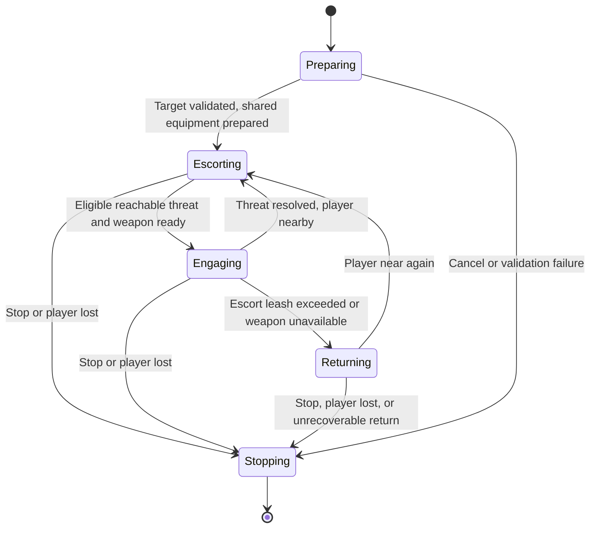
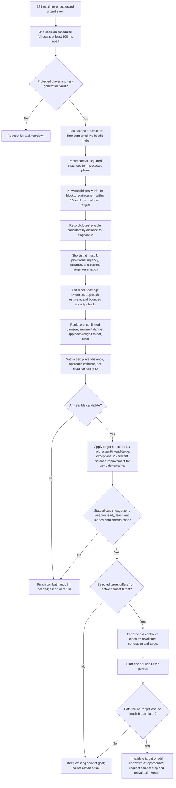

# Protect feature overhaul

Status: **implemented local runtime**, 2026-11-04; simulated regression coverage is in `backend/test/protect.test.ts`. Real-server/version acceptance and mass-volume performance measurements remain outstanding. [spec.md](spec.md) describes the current behavior. Automatic equipment selection/equipping is excluded from the first implementation and specified separately in [EQUIPMENT_DESIGN.md](EQUIPMENT_DESIGN.md).

## 1. Product scope and authority

Protect escorts a named player and responds to eligible threats while staying close enough to continue escorting. It is one long-running task with internal escort/combat states, not a series of follow and attack tasks submitted to the scheduler.

- Canonical UI/action name: **Protect**. Chat command: `!protect [player]`, defaulting to the requesting player.
- Keep `!guard` as a compatibility alias invoking the same task. Normalize legacy dashboard `guard` actions at the application boundary; do not maintain two implementations or separate grants.
- Crew and Owner may start Protect. Introduce canonical `task.protect.start` with the same inherited grants as current guard; update command mappings, shared contracts, task state/UI labels, tests, and catalog version together. Neither an alias nor a legacy permission ID grants extra authority.
- An explicit stop request retains the application's current stop permission. Runtime safety termination requires no player permission. Role edits do not stop or reauthorize an existing Protect task.
- **Protect invocation authorizes the task's eligible defensive actions in full.** In a future player-threat extension, automatic player targeting inside Protect will not perform a second RBAC check or require `task.attack.start`. Standalone Attack remains separately authorized.
- First implementation: supported hostile mobs only. Players are excluded even if they damage the protected player. Player-threat selection is an extension seam, not enabled behavior.

Being eligible under Protect is distinct from being permitted by RBAC to start it. Server PvP rules, target validity, friendly exclusions, protected-player identity, game participation rules, feature availability, and resource limits remain execution/target-policy checks. They must not be disguised as extra role checks. Future automatic player defense must be clearly described to users when enabled because Crew's Protect authority will include it.

## 2. Runtime boundaries

| Proposed module | Responsibility |
| --- | --- |
| `ProtectTask` | Lifecycle, cancellation, state machine, bounded evaluation schedule |
| `ThreatObserver` | Build small observations from Mineflayer entities/events; track recent damage evidence |
| `ThreatSelector` | Pure candidate filtering/ranking and target retention decisions |
| `ProtectCombatAdapter` | Tested PvP start/stop/handoff behavior; scoped movement settings |
| Equipment readiness + shared preparation | Read held-weapon readiness; use EquipmentService at startup/post-meal and the generic upkeep handoff contract |

Use ordinary TypeScript modules in the bot runtime, not services or a generic plugin framework. No React/Socket.IO imports belong here. The command service authorizes task creation; observation and combat remain local and independent of dashboard visibility.

Reuse target/lifecycle helpers from `TrackedPlayerTask` where appropriate, but not its behavior unchanged: a path failure while chasing one mob should normally reject that mob and return to escorting, whereas losing the protected player may terminate Protect. Do not instantiate the existing `AttackTask` internally: it assumes a player target, owns its own task lifecycle, and owns its own weapon preparation and player targeting.

## 3. State machine and movement ownership



- Escorting installs one dynamic follow goal with a three-block radius on entry. Movement updates should not continually reset the goal.
- Engaging delegates movement/combat to PvP for one selected entity. Call attack on entry or a deliberate target switch, not on every scan.
- Returning relinquishes combat first, then follows the protected player. It ignores ordinary attack opportunities until the bot is back inside the resume radius. Immediate self-preservation can terminate the task, not start an unrelated combat controller.
- Stopping invalidates pending transitions, awaits owned operations/cleanup, removes listeners/timers, and restores prior settings before another task acquires the resources.

Serialize transitions, with a generation/cancellation token checked around each awaited operation. Event handlers request reevaluation; they do not independently set goals. Only one transition may run at a time. Revalidate target identity and task generation after asynchronous startup/cleanup.

The installed PvP implementation's stop operation can wait for `path_stop` and has a timeout cleanup path. A late stop can clear a newer goal if controllers overlap. Do not start escorting or another attack until cleanup is confirmed. Do not replace a timeout with a blind new goal; if cleanup cannot be confirmed, end Protect and report failure while preventing new resource ownership until safe. Emergency force-stop is a tested fallback, not the routine transition mechanism, because it can interrupt a jump. See the [PvP implementation](https://github.com/PrismarineJS/mineflayer-pvp/blob/master/src/PVP.ts).

Plugin-owned listeners/timeouts must be included in compatibility testing. In particular, inspect the installed stop-timeout behavior that removes `path_stop` listeners; do not assume an application wrapper automatically makes that behavior safe. Any necessary dependency change or patch should be proposed explicitly, not silently installed.

### 3.1 Cleanup ownership and triggers

Every resource acquired by Protect must have a named owner and a registered disposer. Register disposal immediately after acquisition, including during partial startup. Capture the exact bot instance and run/task generation; callbacks must not act through a mutable reference that may now identify a replacement bot.

| Trigger | Cleanup scope | Outcome |
| --- | --- | --- |
| Switch combat target | Finish old combat startup/stop and detach target-specific handlers before starting the next target | Keep task-level observation and settings lease |
| Threat dies, disappears, or exceeds release radius | Clear selected target, target evidence/selection state, finish combat shutdown | Resume escort or select another candidate |
| Chase path fails | Finish combat shutdown and retire path-attempt handlers; add expiring unreachable exclusion | Reevaluate, without terminating valid escort |
| Leash exceeded or held weapon lost | Finish combat shutdown, clear old pursuit goal and target-specific work | Return/escort; retain task-level observations |
| Explicit Stop, protected-player loss/death/entity replacement, bot death/end, dimension change, startup failure, or unrecoverable error | Full teardown below | One terminal task outcome |
| Dashboard disconnect or role assignment edit | No Protect teardown | Existing task continues |

Entity death/gone may arrive more than once or overlap Stop/disconnect. Cleanup is idempotent: all termination callers receive the same `stopPromise`, each disposer runs at most once, and a terminal outcome is published at most once.

### 3.2 Full teardown sequence

1. Mark the task stopping and increment/invalidate its generation **before awaiting anything**. Abort its signal, prevent new evaluations/transitions, and reject pending requests to acquire its resources.
2. Cancel scheduled decision/reconciliation intervals, urgent reevaluation/debounce callbacks, retry/backoff timers, progress-watchdog timers, target-commit timers if implemented, and task-owned operation deadlines. Drop queued transition intents. In-flight callbacks still verify the generation before any side effect.
3. Detach task-owned observation listeners using their original function references: `entityHurt`, `entityDead`, `entityGone`, `entityMoved` (and spawn/update events only if used), `playerLeft`, `game`, `death`, `end`, and readiness `heldItemChanged`. Also remove task-owned world/chunk/block listeners if the observation adapter subscribes to them. Do not remove Mineflayer's core listeners or another feature's listeners.
4. Drain the serialized transition/startup operation while its aborted state prevents new attacks or goals. Finish the combat adapter's scoped stop operation on the captured bot. Keep the adapter's scoped completion listeners/deadlines alive until that operation settles; do not clear the mechanism needed to finish cleanup in step 2. Only then clear the task's pathfinder goal and any task-owned movement controls. `clearControlStates()` is permitted only while Protect exclusively owns those controls. On an already-ended bot, skip unsupported calls and still finish local disposal.
5. Call the read-only equipment port's unsubscribe and `release(taskGeneration)`. Drain captured-bot startup/preparation and any upkeep handoff before releasing conflicting ownership. An already-sent server action may complete but must not trigger follow-up combat after cancellation. See the shared equipment/upkeep lifecycle for inventory reconciliation.
6. Remove adapter-specific PvP/pathfinder listeners (`startedAttacking`, `stoppedAttacking`, `attackedTarget`, `path_update`, `path_reset`, and transient `path_stop` listeners where actually acquired). Remove only owned listeners, after their pending operations settle. Observe the installed plugin's cleanup limitations described below.
7. Restore all settings changed by Protect on the same owned bot: pathfinder movements and search/time budgets; PvP movements, follow/view/attack ranges, and timing policy **only if changed**. Maintain an explicit snapshot of changed settings. Restoring settings or clearing goals must never touch a newer bot instance or controller.
8. Clear task-local references and collections: protected/selected entities, evidence history, unreachable exclusions, position samples, shortlist/visibility results, pending intents, progress timestamps, dirty/degraded-status flags, equipment subscription, and disposer registry. Preserve bounded externally published audit/history; do not erase shared roster caches or role assignments.
9. Release the movement/combat/settings lease and notify the session coordinator only after cleanup is confirmed. A successor may then acquire resources. Publish the terminal reason and mark the appropriate runtime state once; do not overwrite a session's dead/disconnected state with idle.

Use `try/finally` with per-disposer error collection so one failed listener removal or plugin call does not skip the remaining cleanup. Partial startup failures use this same sequence for resources already acquired. No global `removeAllListeners()` or indiscriminate inventory/goal restoration is allowed in application cleanup.

Avoid self-await deadlocks: a transition reporting terminal failure must unwind its own operation and let the coordinator drain it; it must not await a `stopPromise` that is itself waiting for that transition. Record the terminal reason first, abort further work, and serialize completion outside the active continuation.

**Timeouts do not prove cancellation.** An outer deadline may report cleanup trouble, but a still-running plugin promise can clear a later goal. Do not release resource ownership or start a successor merely because `Promise.race` timed out. Track/drain plugin-owned stop work as well as application work. Emergency force-stop must be tested with the installed plugin's outstanding timeout behavior; it is not sufficient by itself to prove that a delayed normal stop cannot fire. If quiescence cannot be established, expose a cleanup-failed/stopping state and block conflicting tasks until the runtime has safely ended or an explicitly tested recovery completes. Do not allow an indefinite hidden hang: emit the failure/deadline status and provide deployment retirement as recovery.

The installed plugin's broad removal of `path_stop` listeners on timeout is a compatibility concern. Before implementation is considered complete, either prove a safe integration under the task lease or obtain approval for a dependency fix. Application disposers cannot undo listeners already deleted by a plugin. These requirements apply to terminal teardown and ordinary combat-to-follow handoffs.


### Installed-plugin integration and concrete defaults

The implementation lives under `backend/src/tasks/protect/`. `BotSession` composes the shared [TaskCoordinator](TASK_LIFECYCLE.md), which supplies the exclusive task/cleanup gate; no sockets, role checks, or scheduler calls exist in the threat/combat loop. The observer keeps cached entity-reference evidence and monotonic distance samples; its bounded four-element shortlist is maintained in O(N), without sorting all entities. Visibility uses sync-world raycast's default exact collision-shape intersection and a conservative loaded-column bounding-rectangle precheck. The rectangle may report unknown when an extra neighboring column is absent; it never triggers a load. Closest-distance diagnostics are rounded and included on material status changes rather than streamed each scan.

`ProtectCombatAdapter` leases the installed PvP instance's `stop`, movement policy, and `hasShield` hook. All internal PvP stop calls (including entity loss and attack handoffs) use its scoped stop method. It registers `path_stop` before requesting `pathfinder.stop()`, then finalizes a stopped path using public `forceStop()`. If no completion arrives within 1.5 seconds, emergency `forceStop()` clears the owned goal. This fallback can interrupt a jump. The original PvP stop method is never entered during this lease, so its five-second timer and broad listener removal cannot run late. The adapter drains outstanding stop/start work before restoring the exact methods/settings; unrelated `path_stop` listeners remain installed. This is an instance-scoped compatibility shim, not a dependency patch. Compatibility tests exercise installed PvP 1.3.2 methods; rerun/review them on plugin upgrades.

The scoped `hasShield` hook returns false to disable this plugin version's fixed-index creeper logic and delayed shield writes. Protect therefore promises no shield or explosion tactics. This private hook is an explicit compatibility dependency. Other PvP reach/range/timing settings remain unchanged. Shared startup/post-meal equipment preparation is implemented; continuous loadout optimization remains deferred.

Progress timeout is 30 seconds: escorting within three blocks is healthy; combat requires measurable approach or actual hurt events on the selected mob. Mere proximity across a wall does not reset the watchdog. A stalled mob enters five-second exclusion; an unsuccessful escort/return terminates. A ten-second teardown deadline publishes cleanup trouble without releasing the session's lease; delayed operations remain tracked, and failed cleanup blocks successors until deployment retirement. Explicit stop and automatic safety stop each publish one terminal outcome after successful cleanup.

### Private reachability notification

The current termination policy is retained. A `PLAYER_UNREACHABLE` outcome causes the session to send one private `/tell` after teardown, in addition to the existing warning. It explains that no usable route was found within navigation limits and asks the player to move somewhere accessible and request Protect again. Timeout does not prove universal unreachability. Delivery failure is logged, with no public fallback. This applies to escort/return failure, not a mob's temporary exclusion. The message is marked private in the dashboard mirror.

## 4. Target validity, leash, and recovery

Initial values are tunable engineering defaults, not performance guarantees:

| Setting | Proposed default |
| --- | --- |
| Escort radius | 3 blocks |
| Threat acquisition radius around protected player | 10 blocks |
| Current threat release radius around protected player | 16 blocks |
| Maximum bot-to-player combat separation | 12 blocks |
| Resume engagement after returning | Within 5 blocks |
| Unreachable-target exclusion | 5 seconds |
| Decision evaluation interval | 333 ms |
| Recent confirmed aggressor evidence | 3 seconds |

Acquisition and release use different thresholds to prevent oscillation. Reaching the escort leash abandons pursuit and prioritizes return. PvP's own target range is not a substitute: it measures a different relationship and must not allow Protect to abandon the player.

Require a valid tracked protected player, the same observable dimension, loaded target world data, and bounded initial distance. Reuse existing player target limits where applicable. Do not navigate portals or search unloaded chunks. Stop on protected-player death, logout, entity replacement, loss of tracking, or dimension change; report the observable reason without claiming to know a remote location.

A mob dying/disappearing triggers target reevaluation, not task completion. An unreachable mob is temporarily excluded, with its ID and current entity generation, then another threat or escorting is selected. Bound retries; do not retry an unreachable target every evaluation tick. Clear evidence/exclusions on world/run changes and expire them so reused entity IDs cannot inherit stale hostility.

Use bounded non-destructive pathfinding, no digging/pillaring, and restore prior pathfinder/PvP settings. Add state-aware progress checks: a stationary bot within escort radius is healthy; one stalled while returning is not. A failed/stalled return ends Protect with a useful outcome after bounded recovery. Exact timeout values should be established with server fixtures rather than copied blindly from pursuit logic.

## 5. Observation and evidence

Observe existing tracked entities and event notifications. Relevant Mineflayer APIs include entity hurt/death/gone/movement events, bot death/end/game events, held-item changes, and inventory slot updates. The first implementation must not load chunks or issue world queries merely to score candidates. See [Mineflayer API](https://github.com/PrismarineJS/mineflayer/blob/master/docs/api.md).

On supported modern packet paths, `entityHurt` may include the responsible source entity; older status/animation paths can supply the victim alone. Normalize to explicit evidence such as `confirmed_damage_source` versus `proximity_inference`, with a timestamp. Unknown source remains unknown: the nearest mob or a nearby swinging entity is not proof of an attack. Undefined victims/sources and duplicate damage notifications must be tolerated. See the [entity-event implementation](https://github.com/PrismarineJS/mineflayer/blob/master/lib/plugins/entities.js).

Initial candidates are supported hostile mobs only. Use version-aware classification and explicit policy exceptions where needed; avoid universal assumptions about modded mobs. Ignore player damage sources for targeting in the first release, while preserving an observation shape that can represent their category later.

Future player threats can be supplied by another typed candidate policy using the same evidence and selection pipeline. It must exclude the protected player and any configured friendly/participant exclusions and define aggression evidence requirements. No player detector or PvP-retaliation feature is included now, and no additional RBAC operation is introduced for future automatic player defense.

## 6. Threat ranking and switching

Keep two distinct answers: **closest eligible threat** is a geometric distance calculation; **selected threat** is the most relevant feasible target after urgency, evidence, and retention rules. Do not describe a far-away confirmed attacker as the closest entity merely because it wins prioritization.

### Evaluation cadence

Distance evaluation is continuous **for the lifetime of an active Protect task**, not a one-time startup check. The normal decision loop runs every 333 ms (approximately three evaluations per second). Each evaluation snapshots the player's latest known position and recomputes squared 3D distances for currently eligible tracked hostile mobs. New positions are used even if the previous selected target has not changed. The scan does not depend on the live roster panel being open.

Damage, target loss, and held-weapon loss can request an earlier evaluation. Coalesce these requests with the normal timer into one decision scheduler: at most one evaluation runs and one pending reevaluation is remembered. Initially enforce a 100 ms minimum gap between full scans, including urgent scans, so event bursts cannot cause an unbounded scan per packet. The 333 ms interval is the normal cadence, not an absolute response guarantee; event-loop load and Minecraft updates affect actual timing. Immediately invalidate a dead/gone target and request the serialized combat stop without waiting for a new ranking pass. That safety signal does not start a second controller.

`entityMoved` marks observations dirty rather than starting a separate scan. Escorting, Engaging, and Returning continue to refresh observations; state gates determine whether the result may trigger combat. Stopping/finished tasks schedule no scans. Timers and pending scan requests are disposed as specified in section 3.2.

Distance checks are inexpensive local arithmetic over Mineflayer's existing cache; the four-candidate shortlist caps raycasts, and only the selected target gets a pathfinding attempt. A scan does not issue a Minecraft server query or load chunks. This policy bounds work per evaluation, but should still be benchmarked against entity count and concurrent bot count.

### Target-prioritization flow



The diagram describes one pass and its later execution outcomes, not a tight immediate loop. The decision scheduler owns the next pass. No-candidate and state-gate failures preserve Returning/equipment-unavailable behavior rather than blindly restarting Follow. An obstructed target is not automatically unreachable; only relevant execution failures add an unreachable cooldown. A changed target is revalidated after cleanup because it may disappear while the old controller is stopping.

### 6.1 Snapshot the player and eligible entities

1. Resolve the protected player's current `Player.entity` from Mineflayer's `bot.players` using the existing case-insensitive player lookup helper. Confirm it is the same tracked entity generation as this task expects and that `bot.entities[entity.id]` still identifies it. Stop if the protected target is lost; a remembered username or cached position is not enough.
2. Read `Object.values(bot.entities)` once per evaluation. Copy position components into task-local observations; never mutate Mineflayer's live Vec3 values or retain mutable positions as historical samples. Validate finite coordinates and entity validity; reject the bot, protected player, all player entities in the first version, dead/gone entities, unsupported mob categories, and entities in the unreachable cooldown.
3. Use the current run/world generation to scope entity IDs. `entityDead`/`entityGone` invalidate observations immediately. If a damage source no longer exists in the current entity map, keep at most diagnostic evidence; do not create an actionable target from it.

APIs/data: `bot.players`, `bot.entities`, `Entity.id`, `isValid`, `type`/`name`/`kind`, and `Entity.position`. Use `bot.game.dimension` and lifecycle events for world validity; do not assume every entity exposes a trustworthy independent dimension field. These are local cached reads, not server queries. [Mineflayer entities/properties](https://github.com/PrismarineJS/mineflayer/blob/master/docs/api.md#properties)

### 6.2 Calculate distance from the protected player

For protected player position `P = (px, py, pz)` and candidate mob position `M = (mx, my, mz)`:

```text
dx = mx - px; dy = my - py; dz = mz - pz
playerDistanceSquared = dx*dx + dy*dy + dz*dz
playerDistance = sqrt(playerDistanceSquared)
```

Use `M.position.distanceSquared(P.position)` from Vec3, or the equivalent arithmetic over copied coordinates. Compare squared distances in the main scan: a new candidate must be within `10*10`; the existing target may be retained within `16*16`. Compare the bot-to-player squared distance separately with `12*12` for the combat leash. The radii are engineering defaults from section 4.

This is **3D straight-line distance between entity position origins**, including height; it is not horizontal-only distance, eye-to-eye distance, melee reach, or path length. Using the same position metric as the existing behavior keeps the definition predictable. Hitbox/attack reach is left to combat feasibility. Calculate square roots only for the bounded shortlist, temporal estimates, or displayed telemetry.

Find the closest eligible new threat by an O(N) minimum scan over acquisition candidates. Tie-break equal distances by a stable numeric entity ID within the current world generation. No call to `bot.nearestEntity()` is needed: that helper measures from the bot, whereas this feature measures from the protected player. Keep the current target as a retention candidate even if it is outside the acquisition radius, provided it remains inside its release radius.

Example: protected player at `(0,64,0)`, zombie at `(3,64,4)` has squared distance 25, i.e. 5 blocks. A skeleton at `(0,70,0)` is 6 blocks away, not zero. The zombie is geometrically closer. If the skeleton has confirmed recent damage evidence and the zombie does not, the skeleton may nevertheless be the selected threat.

### 6.3 Add evidence and bounded estimates

- **Confirmed damage:** subscribe with `bot.on('entityHurt', handler)`; when the victim is the protected entity and an optional valid source entity is supplied, record that source for three seconds. Deduplicate overlapping notifications. Missing source does not imply the closest mob caused the damage.
- **Approach:** keep two timestamped distance samples for a candidate. `closingSpeed = (previousDistance - currentDistance) / elapsedSeconds`; positive values indicate approach relative to the moving player. Ignore stale/nonpositive time deltas; require consistent positive samples, provisionally above 0.5 blocks/second, before calling it approaching. This does not prove pursuit intent. Optionally estimate time to a three-block danger envelope as `max(distance - 3, 0) / closingSpeed`; when closing speed is unknown/nonpositive, time is unknown, not zero.
- **Obstruction:** preselect at most four candidates using cheap provisional urgency and player distance, reserving a slot for the valid current target. Check a ray from candidate body/eye position to the protected player's body center using the synchronous `bot.world.raycast(from, normalizedDirection, range, matcher)`. Use collision shapes for the blocking predicate; handle a zero-length ray directly. Precheck each traversed column with synchronous `bot.world.getColumn(chunkX, chunkZ)` or `getColumnAt(position)` so missing data produces `unknown`. A null raycast result alone is not proof of clear visibility across unloaded data. No asynchronous world load/storage API is used.
- **Ranged/inherent danger:** use an explicit supported-mob policy by entity name/category. A known ranged mob with a clear ray is a plausible threat, not proof it is aiming at the player. Fuse/attack state needs version-verified metadata names as described below. Unsupported metadata does not earn a confirmed-danger label.

`entityMoved` may mark sampling dirty, but position samples use elapsed wall time rather than an assumed tick rate. Use a monotonic application clock for durations. APIs are Mineflayer events/entity positions and the existing Vec3 vector operations; the estimates are Kanabot logic, not a Mineflayer threat-score API. The sync-world distinction and raycast signature are documented by [Prismarine World](https://github.com/PrismarineJS/prismarine-world/blob/master/docs/API.md).

### 6.4 Choose and retain a target

Use deterministic priority tiers, not an opaque weighted sum:

| Tier (smaller is higher priority) | Rule |
| --- | --- |
| 0 | Valid supported mob confirmed damaging the protected player in the last three seconds |
| 1 | Known clear line to the player and within a provisional three-block danger envelope, or version-verified imminent hazard |
| 2 | Sustained approach or known ranged mob with a clear line to the player |
| 3 | Other eligible nearby hostile mobs |

Rank within a tier by player distance first, then estimated approach time when known, bot distance, and entity ID for stable ties. Missing estimates sort after known estimates and never invent certainty. Obstructed/unknown rays do not qualify a mob for the clear-line promotions; obstruction does not prove a target is unreachable by walking around it.

The shortlist limits expensive checks. Refill available shortlist slots on later evaluations and avoid claiming a globally optimal danger ranking: selection is a bounded heuristic over observed entities. Always consider the current target and highest known damage-evidence candidates when constructing it; use provisional urgency before distance so an observed aggressor is not crowded out by four closer incidental mobs.

Apply retention after ranking: keep the current target for one second unless it becomes invalid/infeasible, exceeds a hard limit, or a higher-priority tier appears. After that period, switch for a higher tier or a same-tier challenger at least 25% closer to the player. Near-equal distances retain the current target. These thresholds are tunable defaults, not changes to combat reach.

Before engaging, verify the task generation, equipment readiness, escort leash, and loaded target data again. Initiate one bounded pursuit through `bot.pvp.attack(entity)`, which installs its own pathfinder goal; do not simultaneously call `goto()` or compute full paths for every candidate. Observe `bot.on('path_update', ...)` for `noPath`/`timeout` and the state-aware progress watchdog. A failure marks that target temporarily unreachable and requests a serialized return/reevaluation. Changing escort goals uses `bot.pathfinder.setGoal(new goals.GoalFollow(playerEntity, 3), true)` only after combat cleanup completes. [PvP API](https://github.com/PrismarineJS/mineflayer-pvp/blob/master/docs/api.md), [pathfinder APIs/events](https://github.com/PrismarineJS/mineflayer-pathfinder)

While Returning or equipment-unavailable, the observer may continue measuring threats, but it must not bypass those states to start a chase. For diagnostics expose both closest eligible distance and selected target/reason; keep the distinction visible in tests and telemetry.

Creeper urgency does not mean sprinting into an explosion. Use fuse/attack metadata only when version-named semantics have been verified; no fixed protocol indices. If an immediate hazard cannot be handled under the initial melee policy, report degraded protection and preserve escort constraints. Full explosion evasion, ranged weapons, shielding tactics, and projectile interception are not initial guarantees. Do not rely on the plugin's historical shield behavior as proof of explosion safety.

## 7. Equipment readiness and upkeep handoffs

The shared [equipment foundation](EQUIPMENT_DESIGN.md) now prepares supported melee gear at startup and after food. The read-only held-weapon port remains Protect's immediate readiness observer: no usable held sword/axe means escort-only behavior; loss/breakage interrupts engagement, and a later usable held weapon permits reevaluation. Continuous automatic weapon upgrades or situational ranking outside these preparation boundaries remain follow-ups.

Protect implements the generic EquipmentOwner contract with a revisioned best-melee requirement. During a meal it retains its task slot and observers, pauses decisions/progress watchdogs, drains serialized transitions and scoped combat/pending looks, then clears motion. Upkeep reconciles the current requirement through the shared inventory lane with readback. Resume clears stale selection/path failures, resets progress and recomputes threats from current state. A missing post-meal weapon leaves the task suspended with visible blocked upkeep status and readiness retries; it never restarts fighting with food. Normal weapon loss outside a food handoff retains escort degradation.

Food policy does not import Protect. Armor runs through the same inventory executor without resetting compatible movement. Startup/collection writes from the autonomous armor plugin have been replaced. Exact handoff/failure/teardown rules and selection limitations are in [BOT_UPKEEP_DESIGN.md](BOT_UPKEEP_DESIGN.md).

## 8. Performance and observability

Use a 333 ms bounded reconciliation loop plus coalesced urgent reevaluation for damage, target loss, and held-item loss. Movement events only mark state dirty; they must not launch overlapping loops. Bound evaluations, raycasts, evidence history, retries, and transition work. Continue runtime evaluation even with no dashboard viewers; player-list telemetry remains independently lazy.

The previous Guard loop already checked distances every 333 ms. The overhaul's substantial gains are evidence-based prioritization, stable target retention, bounded escort/chase recovery, exclusive movement ownership, and explicit teardown. The richer decision pass may cost more CPU than nearest-mob selection; shortlist/scan limits and measurements must justify that cost. Smoother or safer real combat remains an acceptance-test goal until supported-server verification is complete.

Expose structured Protect state, protected player, selected threat, selection reason/confidence, degraded equipment status, and task outcome. Send/log state changes and material target changes, not every scan. A future dashboard can render these without importing task classes or scoring rules. No database, model call, or network round trip belongs in the reaction loop.

## 9. API and compatibility review

Research used upstream documentation and the installed dependencies (`mineflayer` 4.37.x, `mineflayer-pvp` 1.3.2, pathfinder 2.4.x). Verify exact lockfile versions at implementation time; upstream source is not necessarily the installed package. For example, the installed PvP code uses the deprecated physics-event alias and differs from upstream in attack range. Keep combat reach within supported server/plugin semantics; do not increase it to compensate for decision latency.

Prototype and test combat handoff, equipment-loss handling, and cleanup against the installed packages before finalizing the adapter. Reuse the existing APIs first; a new combat dependency or uploaded plugin system is not a prerequisite.

## 10. Implementation and acceptance

The implemented scope includes rename/aliases, RBAC mapping migration, ProtectTask and state machine, threat observations/scoring, leash/recovery, combat adapter, held readiness, structured state, and tests. Shared equipment preparation and upkeep handoffs have subsequently been added; player-threat selection remains excluded.

Acceptance scenarios:

- Protect/legacy Guard requests resolve to the same Crew-authorized capability; unauthorized requests cannot start work.
- Dynamic escort goal is not reset each scan; only one movement/combat owner exists during transitions.
- Stop during pending attack startup/cleanup cannot allow a late attack or erase a later task's goal.
- Mob death/loss returns to escort or another eligible threat; protected-player loss/dimension change ends the task predictably.
- The bot returns when the player outruns it and cannot chase indefinitely outside the leash.
- A known aggressor outranks a merely closer mob; unknown damage sources are not fabricated; target hysteresis prevents near-tie thrashing.
- Unreachable targets cool down without repeated expensive searches; return failures and missing chunks have bounded outcomes.
- The held-readiness observer performs zero inventory writes; shared preparation uses the EquipmentService lane. Losing the held weapon ends melee engagement; holding a suitable weapon later restores readiness without restarting Protect.
- All player entities remain excluded from initial target selection, regardless of role or damage events. Future player-candidate policy tests can be added without changing authorization or task scheduling.
- Dashboard disconnection and role edits leave an already-running Protect task intact. All owned listeners/timers/settings are cleaned up on termination.
- Verify 3D/squared-distance examples, exact radius boundaries, same-distance ties, an aggressor farther than the closest mob, stale/reused entity IDs, and unknown chunks on ray paths. Confirm no chunk loads occur and expensive checks respect the shortlist cap.
- Repeat start/stop, partial startup failure, target handoff, bot replacement, plugin-stop timeout, and disconnect during cleanup. Listener/timer counts and changed settings return to their baseline; the outcome fires once and a successor never loses its goal to late cleanup. Inject disposer failures to verify remaining disposers still run and unconfirmed cleanup blocks conflicting execution.
- Run deterministic fixtures plus authorized real-server scenarios covering the supported versions, damage-source availability, PvP plugin timing, and cancellation. Mocks alone cannot prove smooth combat or reliable server damage attribution.
